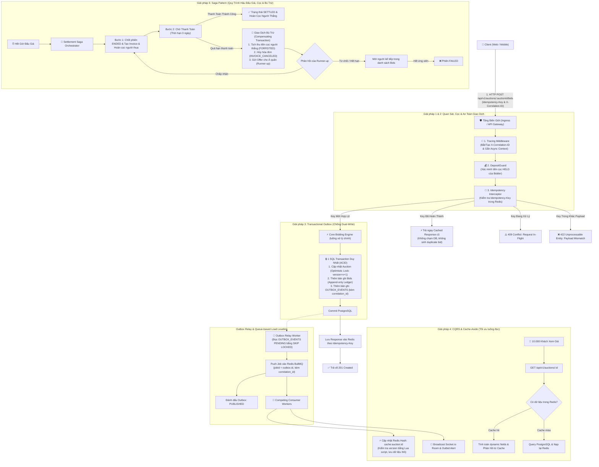
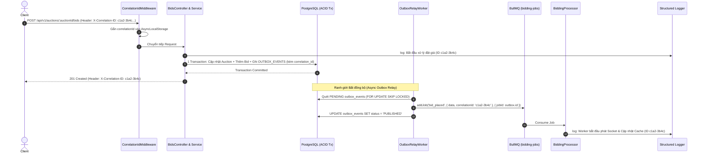
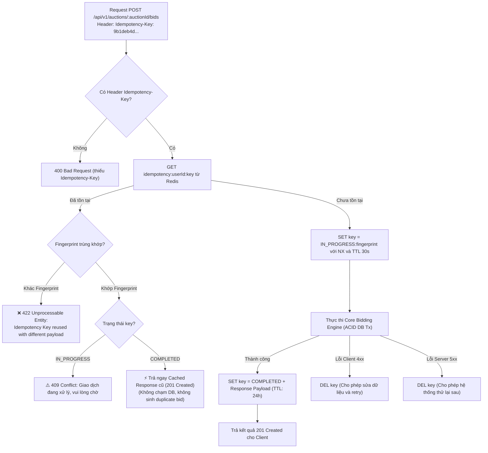
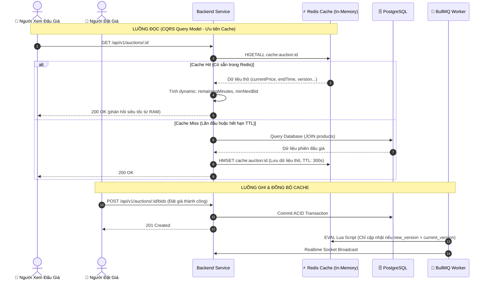
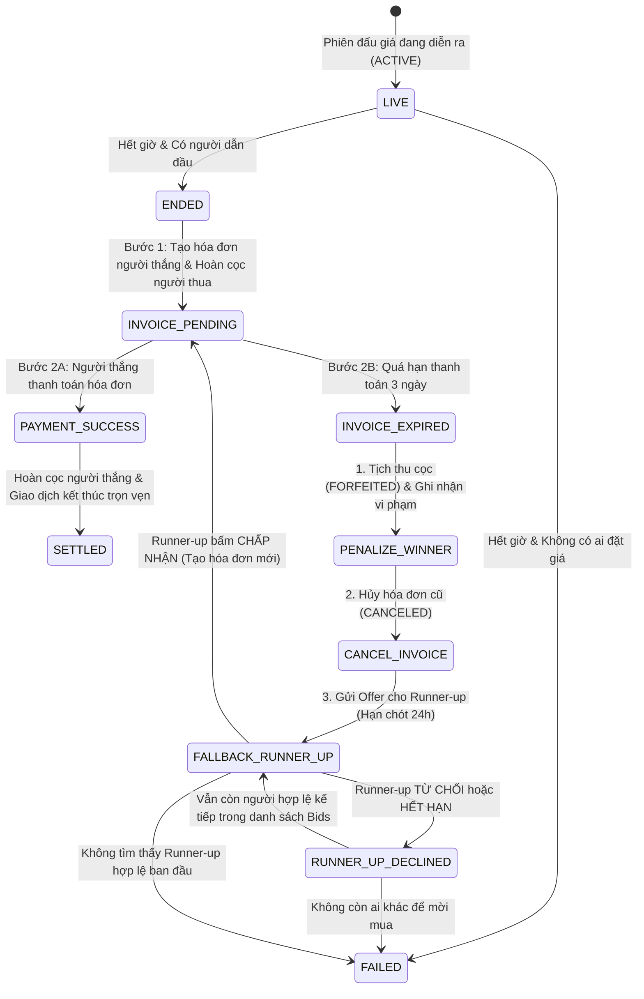

# Đề xuất kiến trúc nâng cao cho hệ thống đấu giá trực tuyến

*Phân tích năm giải pháp kiến trúc nhằm tăng độ tin cậy, khả năng mở rộng và khả năng quan sát của hệ thống*

Tài liệu đề xuất năm giải pháp kiến trúc cho **hệ thống đấu giá trực tuyến**: sử dụng mã tương quan để liên kết nhật ký, bảo đảm tính lũy đẳng của yêu cầu đặt giá, áp dụng Transactional Outbox để giảm nguy cơ mất sự kiện, tối ưu luồng đọc bằng CQRS kết hợp bộ nhớ đệm và tổ chức quy trình hậu đấu giá theo Saga. Mỗi giải pháp được trình bày theo ba nội dung: **WHAT (Khái niệm)**, **WHY (Lý do áp dụng)** và **HOW (Hướng triển khai)**.

**Phạm vi:** Tài liệu mô tả phương án thiết kế cho bài tập môn học, không phải báo cáo kết quả triển khai thực tế. Các con số về tải, thời gian phản hồi và thời gian thực hiện (nếu có) mang tính minh họa hoặc ước lượng, cần được kiểm chứng bằng thử nghiệm.

---

## 0. Tổng quan kiến trúc hệ thống

Sơ đồ sau thể hiện mối liên hệ giữa năm giải pháp, từ lúc người dùng gửi yêu cầu đặt giá, qua bước lưu giao dịch và xử lý sự kiện bất đồng bộ, đến quá trình chốt phiên và xử lý thanh toán:



---

## 1. Giải pháp 1: Correlation ID và Distributed Tracing (Truy vết yêu cầu)

### 1.1. WHAT — Khái niệm
**Correlation ID** là mã dùng để liên kết các bản ghi nhật ký phát sinh từ cùng một yêu cầu, kể cả khi yêu cầu đi qua API, cơ sở dữ liệu, hàng đợi và worker xử lý nền. Đây là bước triển khai cơ bản để cải thiện khả năng quan sát. **Distributed Tracing** mở rộng cách tiếp cận này bằng việc ghi nhận các *span* và quan hệ giữa chúng, từ đó hỗ trợ phân tích thời gian xử lý theo từng chặng. Hai khái niệm có liên quan nhưng không hoàn toàn đồng nhất.

### 1.2. WHY — Lý do áp dụng
* **Bài toán thực tế:** Trong kiến trúc bất đồng bộ (Queue-based Load Leveling), khi người dùng gửi yêu cầu `POST /api/v1/auctions/:auctionId/bids`, luồng HTTP kết thúc ngay sau khi commit cơ sở dữ liệu. Sau đó, Outbox Relay Worker và Competing Consumer Workers của BullMQ tiếp tục nhận tác vụ bất đồng bộ để cập nhật bộ nhớ đệm và phát thông báo qua WebSocket.
* **Hậu quả nếu không có:** Khi người dùng khiếu nại *"Tôi đặt giá thành công nhưng 30 giây sau mới nhận được thông báo"*, nhóm phát triển sẽ khó liên kết nhật ký giữa HTTP request, Outbox poller và Worker nền, làm tăng thời gian tìm nguyên nhân sự cố.
* **Lợi ích kiến trúc:** 
  1. Cho phép liên kết toàn bộ dấu vết (Traces) của một giao dịch qua các ranh giới mạng và ranh giới bất đồng bộ.
  2. Ghi nhận `correlation_id` xuyên suốt từ bảng `outbox_events` vào metadata của job trong BullMQ (do worker chạy tiến trình riêng không có context `AsyncLocalStorage` của HTTP request).

### 1.3. HOW — Hướng triển khai

#### A. Cơ chế hoạt động
1. **NestJS Middleware (`CorrelationIdMiddleware`):** Đọc header `X-Correlation-ID` từ client (nếu được hệ thống tin cậy) hoặc tự tạo UUID mới.
2. **Context Storage:** Lưu mã này vào `AsyncLocalStorage` (Node.js native) để mọi Service, Repository hoặc Logger có thể truy xuất mà không cần truyền param thủ công qua từng hàm.
3. **Outbox Persistence & Queue Enrichment:** Lưu `correlation_id` vào cột của bảng `outbox_events` trong giao dịch SQL. Khi Relay Worker đẩy job vào BullMQ, truyền tiếp `correlation_id` vào metadata của Job.
4. **Định dạng nhật ký:** Sử dụng nhật ký có cấu trúc JSON với các trường `timestamp`, `correlationId`, `level`, `context` và `message`.

#### B. Sơ đồ tuần tự
Sơ đồ tuần tự phản ánh chính xác mô hình Transactional Outbox: API ghi nhận sự kiện vào bảng outbox trong cùng giao dịch cơ sở dữ liệu chứ không gọi trực tiếp hàng đợi:



---

## 2. Giải pháp 2: Idempotency Key (Ngăn xử lý trùng yêu cầu đặt giá)

### 2.1. WHAT — Khái niệm
**Idempotency (tính lũy đẳng)** là đặc tính giúp việc thực hiện lại cùng một yêu cầu không tạo thêm tác động nghiệp vụ ngoài lần xử lý đầu tiên. Trong hệ thống đấu giá, client gửi header `Idempotency-Key` (UUID ngẫu nhiên được sinh ra cho mỗi lần người dùng bấm nút) để máy chủ nhận diện các lần thử lại do sự cố mạng. Khi một yêu cầu đã hoàn tất, hệ thống trả lại ngay kết quả đã lưu mà không ghi nhận thêm lượt đặt giá vào cơ sở dữ liệu.

### 2.2. WHY — Lý do áp dụng
* **Bài toán thực tế:** Kết nối mạng di động của người dùng bị chập chờn. Người dùng nhấn "Đặt giá 50.000.000đ", máy chủ đã xử lý giao dịch thành công trong cơ sở dữ liệu, nhưng kết nối mạng bị rớt trước khi gói tin phản hồi kịp về đến thiết bị. Client kích hoạt cơ chế retry tự động hoặc người dùng bấm lại nút một lần nữa.
* **Hậu quả nếu không có tính lũy đẳng:** 
  1. Trong hệ thống hiện tại, logic nghiệp vụ đã chặn người dẫn đầu tự đặt giá tiếp. Do đó, request retry lần hai sẽ bị máy chủ từ chối với lỗi `400 Bad Request` mang thông báo: *"Bạn đang là người trả giá cao nhất"*. Điều này khiến người dùng vô cùng hoang mang, lầm tưởng rằng thao tác đặt giá của mình vừa bị thất bại.
  2. Nếu không có cơ chế phát hiện request đang xử lý (In-flight), hai request đồng thời gửi cùng lúc có thể gây xung đột khóa lạc quan (`409 Conflict`) không cần thiết.
* **Mức độ phù hợp:** Idempotency Key là tiêu chuẩn bắt buộc cho mọi API có tác dụng phụ (Side Effect) quan trọng trong thương mại điện tử và tài chính.

### 2.3. HOW — Hướng triển khai

#### A. Trạng thái yêu cầu trong Redis & Kiểm tra Dấu vân tay (Payload Fingerprint)
Khóa trong Redis: `idempotency:<userId>:<idempotencyKey>`
* **Trạng thái 1: `IN_PROGRESS` (TTL: 30 giây):** Đánh dấu yêu cầu đang được xử lý, sử dụng lệnh nguyên tử `SET idempotency:<userId>:<key> "IN_PROGRESS:<fingerprint>" NX EX 30`. Nếu trả về `false`, trả ngay lỗi `409 Conflict` (request in-flight).
* **Trạng thái 2: `COMPLETED` (TTL: 24 giờ):** Lưu mã trạng thái HTTP và toàn bộ payload phản hồi của lần thực thi đầu tiên.
* **Kiểm tra sai lệch Payload (Mã lỗi `422 Unprocessable Entity`):** Hệ thống băm nội dung Body (`SHA-256 fingerprint`). Nếu cùng một `Idempotency-Key` được gửi lại nhưng nội dung Body khác lần trước (ví dụ thay đổi số tiền đặt giá), hệ thống lập tức từ chối với mã lỗi `422 Unprocessable Entity` nhằm ngăn chặn hành vi sử dụng lại key sai mục đích.
* **Chính sách lỗi 4xx:** Các lỗi xuất phát từ phía client (như `400 Bad Request` do vi phạm bước giá, `422 Payload Mismatch`, `403 Forbidden` do thiếu cọc) **không được lưu cache lâu** hoặc bị xóa key ngay lập tức (`DEL`) để cho phép người dùng sửa dữ liệu và thử lại hợp lệ.

#### B. Lưu đồ xử lý Idempotency


---

## 3. Giải pháp 3: Transactional Outbox (Giảm rủi ro mất sự kiện khi ghi dữ liệu)

### 3.1. WHAT — Khái niệm
**Transactional Outbox** là mẫu kiến trúc giải quyết triệt để bài toán **Dual-Write Problem**. Thay vì ghi vào cơ sở dữ liệu rồi gọi hàng đợi Redis trong cùng một hàm, hệ thống lưu bản ghi sự kiện vào bảng `outbox_events` nằm trong cùng một SQL Transaction với việc cập nhật `Auction` và thêm bản ghi `Bid`. Worker nền sau đó quét bảng này và đẩy sự kiện sang hàng đợi tin nhắn BullMQ một cách đáng tin cậy.

### 3.2. WHY — Lý do áp dụng
* **Lỗ hổng "Dual-Write Problem":**
  Trong kiến trúc gọi trực tiếp hàng đợi:
  ```ts
  await dbTransaction.commit(); // Bước 1: Lưu vào PostgreSQL
  await redisQueue.addJob();    // Bước 2: Gửi vào Redis Queue
  ```
  Nếu server gặp sự cố mất điện, container bị khởi động lại, hoặc mạng nội bộ giữa server và Redis chập chờn xảy ra **ngay giữa bước 1 và bước 2**:
  * Bản ghi đặt giá đã lưu thành công trong cơ sở dữ liệu.
  * Nhưng sự kiện không bao giờ được đưa vào Redis.
  * **Hậu quả:** WebSocket không phát sóng cập nhật giá, cache không được đồng bộ, và những người xem khác tiếp tục nhìn thấy giá cũ.
* **Giải pháp:** Cơ sở dữ liệu quan hệ bảo đảm tính nguyên tử (Atomicity): việc đặt giá và việc ghi nhận sự kiện outbox sẽ cùng thành công hoặc cùng bị hủy bỏ (`Rollback`).

### 3.3. HOW — Hướng triển khai

#### A. Thiết kế bảng `outbox_events` có `correlation_id`
```sql
CREATE TABLE outbox_events (
    id UUID PRIMARY KEY DEFAULT gen_random_uuid(),
    correlation_id VARCHAR(64) NOT NULL, -- Mã truy vết liên kết từ HTTP Request
    aggregate_type VARCHAR(64) NOT NULL, -- 'AUCTION'
    aggregate_id UUID NOT NULL,          -- auctionId
    event_type VARCHAR(64) NOT NULL,     -- 'BID_PLACED', 'AUCTION_ENDED'
    payload JSONB NOT NULL,              -- Dữ liệu sự kiện
    status VARCHAR(20) DEFAULT 'PENDING',-- 'PENDING', 'PUBLISHED', 'FAILED'
    retry_count INT DEFAULT 0,
    created_at TIMESTAMP DEFAULT NOW(),
    processed_at TIMESTAMP
);
CREATE INDEX idx_outbox_pending ON outbox_events(status, created_at) WHERE status = 'PENDING';
```

#### B. Luồng xử lý hai giai đoạn
1. **Tầng 1 (Synchronous Hot Path - Ghi đồng bộ trong DB Transaction):**
   ```ts
   await dataSource.transaction(async (manager) => {
     // 1. Cập nhật Auction với Optimistic Lock (version = version + 1)
     await manager.update(Auction, { id: auctionId, version: currentVersion }, { ... });
     // 2. Thêm bản ghi Bid vào sổ cái bất biến
     await manager.save(Bid, { auctionId, bidderId, amount, status: BidStatus.VALID });
     // 3. Ghi Outbox Event kèm Correlation ID vào cùng transaction
     await manager.save(OutboxEvent, {
       correlationId: correlationIdStorage.get(),
       aggregateType: 'AUCTION',
       aggregateId: auctionId,
       eventType: 'BID_PLACED',
       payload: { auctionId, amount, bidderName, ... },
       status: 'PENDING'
     });
   });
   // Commit thành công -> Trả ngay 201 Created cho Client
   ```
2. **Tầng 2 (Asynchronous Poller / Relay Worker - Đẩy sự kiện định kỳ):**
   * Scheduled Worker quét bảng `outbox_events` với chu kỳ 200–500ms.
   * Sử dụng câu lệnh khóa an toàn chống trùng lặp giữa nhiều worker:
     ```sql
     SELECT * FROM outbox_events 
     WHERE status = 'PENDING' 
     ORDER BY created_at ASC 
     LIMIT 100 
     FOR UPDATE SKIP LOCKED;
     ```
   * Đẩy job vào BullMQ với `jobId = outbox_events.id` (Idempotent Consumer, loại bỏ trùng lặp).
   * Cập nhật `status = 'PUBLISHED'` và `processed_at = NOW()`.

---

## 4. Giải pháp 4: CQRS và Cache-Aside (Tối ưu luồng đọc dữ liệu)

### 4.1. WHAT — Khái niệm
**CQRS (Command Query Responsibility Segregation)** phân tách rõ ràng luồng ghi dữ liệu (Command) và luồng truy vấn dữ liệu (Query). Với **Cache-Aside**, luồng đọc ưu tiên lấy dữ liệu từ Redis In-Memory; chỉ khi cache bị lỡ (Cache miss), hệ thống mới truy vấn PostgreSQL và nạp ngược lại vào cache.

### 4.2. WHY — Lý do áp dụng
* **Đặc thù tải bất đối xứng:** Trong một phiên đấu giá sôi nổi (ví dụ đồ sưu tầm hiếm), có thể có 10.000 người dùng liên tục theo dõi bảng giá nhưng chỉ vài chục người đặt giá mỗi phút.
* **Bảo vệ tài nguyên:** Nếu mỗi lượt đọc đều thực hiện câu lệnh `SELECT` kèm `JOIN` bảng `products`, `users`, `bids` trên PostgreSQL, connection pool sẽ cạn kiệt và làm nghẽn giao dịch đặt giá (Hot Path).
* **Mục tiêu hiệu năng:** Đọc dữ liệu từ bộ nhớ RAM của Redis đạt độ trễ cực thấp (< 2ms), giải phóng toàn bộ năng lực của PostgreSQL cho luồng ghi ACID.

### 4.3. HOW — Hướng triển khai

#### A. Cache Dữ Liệu Thô (Raw Data) Thay Vì Dữ Liệu Hiển Thị (View Data)
Khóa trong Redis: `cache:auction:{id}` (Redis Hash).
* **Chỉ lưu dữ liệu thô:** Lưu `id`, `currentPrice`, `highestBidderId`, `highestBidderName`, `totalBids`, `endTime`, `status`, `version`.
* **Không lưu dữ liệu phụ thuộc thời gian:** Các trường như `remainingMinutes`, `minNextBid`, `isEnded` **không được lưu trong cache** mà được tính toán động (dynamic computed) tại thời điểm tầng Controller/Service đọc dữ liệu để đảm bảo không bị sai lệch theo thời gian thực.

#### B. Ngăn Race Condition bằng Lua Script Kiểm Tra Version
Khi sự kiện `BID_PLACED` được tiêu thụ từ BullMQ Worker, nếu mạng bị trễ hoặc worker xử lý song song, một sự kiện sinh ra trước có thể đến sau sự kiện sinh ra sau. Để tránh hiện tượng giá cũ ghi đè lên giá mới, Worker chỉ cập nhật cache thông qua **Lua Script nguyên tử**:

```lua
-- KEYS[1]: cache:auction:{id}
-- ARGV[1]: new_version, ARGV[2]: current_price, ARGV[3]: highest_bidder_id, ARGV[4]: total_bids
local current_version = redis.call('HGET', KEYS[1], 'version')
if not current_version or tonumber(ARGV[1]) > tonumber(current_version) then
    redis.call('HMSET', KEYS[1], 
        'version', ARGV[1], 
        'currentPrice', ARGV[2], 
        'highestBidderId', ARGV[3], 
        'totalBids', ARGV[4]
    )
    return 1
else
    return 0 -- Bỏ qua vì dữ liệu trong cache đã mới hơn
end
```

#### C. Sơ đồ tuần tự Luồng Đọc & Ghi


---

## 5. Giải pháp 5: Saga Pattern (Quy Trình Hậu Đấu Giá, Tiền Cọc & Bù Trừ)

### 5.1. WHAT — Khái niệm
**Saga Pattern** điều phối quy trình nghiệp vụ phức tạp kéo dài qua nhiều ngày (Long-running process) sau khi phiên đấu giá kết thúc. Thay vì duy trì một transaction cơ sở dữ liệu mở liên tục trong 3 ngày chờ người thắng thanh toán (điều bất khả thi), Saga chia quy trình thành nhiều giao dịch cục bộ độc lập. Khi phát sinh vi phạm hoặc quá hạn thanh toán, Saga kích hoạt các **Giao dịch Bù trừ (Compensating Transactions)** để xử lý tài chính và tự động mời Á quân.

### 5.2. WHY — Lý do áp dụng
* **Nghiệp vụ hậu đấu giá thực tế:**
  1. **Tạm giữ và hoàn cọc (Deposit Management):** Người tham gia phải đặt cọc trước (`DepositGuard`). Khi phiên kết thúc, toàn bộ người thua được hoàn cọc ngay lập tức; cọc của người thắng được giữ lại đảm bảo trách nhiệm mua.
  2. **Thời hạn thanh toán:** Người trúng đấu giá có **3 ngày** để thanh toán hóa đơn (`Invoice`).
  3. **Xử lý vi phạm bùng hàng (Default on Payment):** Nếu người thắng không thanh toán đúng hạn, hệ thống cần tự động:
     * Tịch thu tiền đặt cọc làm phí phạt vi phạm (`FORFEITED`).
     * Hủy bỏ hóa đơn chưa thanh toán (`CANCELED`).
     * Ghi nhận vi phạm tài khoản.
     * Tự động gửi lời mời mua sản phẩm kèm hạn chót cho **người trả giá cao hợp lệ kế tiếp (Runner-up)**.
     * Xử lý trường hợp Runner-up từ chối hoặc hết hạn để tiếp tục chuyển giao cho người tiếp theo, hoặc kết thúc phiên với trạng thái `FAILED`.

### 5.3. HOW — Hướng triển khai

#### A. Tiền Cọc Giả Lập (Mock Deposits) & DepositGuard
* **Bảng `deposits`:**
  * `status`: `HELD` (đang tạm giữ), `REFUNDED` (đã hoàn trả), `FORFEITED` (bị tịch thu do bùng hàng).
  * Khóa ràng buộc `[auction_id, user_id]`.
* **`DepositGuard`:** Được gắn vào endpoint `POST /api/v1/auctions/:auctionId/bids`. Nếu người dùng chưa có bản ghi cọc trạng thái `HELD` cho phiên đấu giá này, Guard lập tức ném ra ngoại lệ `403 Forbidden: Bạn phải đặt cọc để tham gia đấu giá phiên này`.
* **Vòng đời tiền cọc:**
  * Người thua: Tự động chuyển `REFUNDED` ngay khi phiên đấu giá đóng (`ENDED`).
  * Người thắng thanh toán thành công: Tiền cọc được hoàn trả `REFUNDED` (hoặc cấn trừ hóa đơn).
  * Người thắng bùng hàng quá hạn: Tịch thu chuyển sang `FORFEITED`.

#### B. Bảng `settlements` Quản Lý State Machine Của Saga
Vì bảng `auctions` có enum trạng thái cố định (`DRAFT`, `UPCOMING`, `ACTIVE`, `ENDED`, `FAILED`, `CANCELED`), bảng `settlements` được thiết kế riêng biệt để theo dõi tiến trình chuyển đổi trạng thái của Saga:
* **Trạng thái Saga (`SettlementStatus`):**
  * `INVOICE_PENDING`: Đã kết thúc phiên, hóa đơn đã tạo, đang chờ thanh toán.
  * `SETTLED`: Đã thanh toán đầy đủ, quy trình hoàn tất thành công.
  * `FALLBACK_RUNNER_UP`: Người thắng vi phạm quá hạn, đang phát hành offer mời Á quân.
  * `FAILED`: Không có người bid khi hết giờ, hoặc tất cả runner-up đều từ chối/hết hạn.
* **Bỏ ràng buộc `OneToOne` giữa Invoice và Auction:** Chuyển sang quan hệ `ManyToOne` (một Auction có thể có nhiều Invoice) vì khi chuyển nhượng cho Runner-up, hệ thống cần sinh hóa đơn thứ hai độc lập.

#### C. Sơ đồ Chuyển Trạng Thái Toàn Diện (Bao gồm Runner-up Decline & Expire)


#### D. Hợp Đồng API & Sự Kiện Realtime Cho Giao Diện Frontend

| Method | Endpoint | Mô tả chức năng |
|---|---|---|
| `POST` | `/api/v1/auctions/:id/deposits` | Đặt cọc giả lập tham gia phiên đấu giá |
| `GET` | `/api/v1/auctions/:id/deposits/me` | Kiểm tra tình trạng cọc của tôi tại phiên |
| `GET` | `/api/v1/me/invoices` | Danh sách hóa đơn cần thanh toán của tôi |
| `POST` | `/api/v1/invoices/:id/pay` | Thanh toán hóa đơn giả lập |
| `GET` | `/api/v1/me/offers` | Danh sách lời mời mua dành cho Á quân (Runner-up) |
| `POST` | `/api/v1/offers/:id/accept` | Chấp nhận mua sản phẩm theo giá bid của mình |
| `POST` | `/api/v1/offers/:id/decline` | Từ chối lời mời mua sản phẩm |

**Sự kiện WebSocket Realtime (`AuctionGateway`):**
* `auction_ended`: Phát sóng tới Room `auction:{auctionId}` khi phiên kết thúc với trạng thái `ENDED` (kèm tên người thắng và giá chốt) hoặc `FAILED`.
* `offer_received`: Phát sóng trực tiếp tới Room cá nhân `user:{userId}` của Runner-up khi nhận được lời mời mua sản phẩm.
* `invoice_created`: Thông báo hóa đơn thanh toán mới được tạo kèm hạn chót.

#### E. Thống Nhất Chính Sách Phạt Quá Hạn
Tài liệu phân tích và thiết kế đưa ra cơ chế linh hoạt (Configurable Policy): Khi người trúng đấu giá quá hạn thanh toán, hệ thống bắt buộc thực hiện **tịch thu tiền cọc (`FORFEITED`)** và **hủy hóa đơn**. Việc có khóa vĩnh viễn tài khoản (`account_status = BANNED`) hay chỉ trừ điểm uy tín (`ratingScore`) và tăng số lần vi phạm được điều khiển thông qua cấu hình chính sách của sàn đấu giá, tránh việc khóa cứng trong cơ sở dữ liệu làm mất đi tính linh hoạt trong vận hành thực tế.

---

## 6. Ma trận tham khảo tác động đến thuộc tính chất lượng

Bảng dưới đây minh họa mức độ đóng góp tương đối của từng giải pháp đối với một số thuộc tính chất lượng. Đây là nhận định định tính của nhóm, **không phải điểm số do ISO/IEC 25010 quy định**:

| Mẫu Kiến Trúc (Architectural Pattern) | Tính Toàn Vẹn Dữ Liệu (Integrity) | Tính Sẵn Sàng (Availability) | Hiệu Năng & Thông Lượng (Performance) | Khả Năng Quan Sát (Observability) | Khả Năng Chống Lỗi (Fault Tolerance) |
|---|:---:|:---:|:---:|:---:|:---:|
| **1. Distributed Tracing & Correlation ID** | | | | ⭐⭐⭐⭐⭐ | ⭐⭐⭐⭐ |
| **2. Idempotency Keys** | ⭐⭐⭐⭐⭐ | ⭐⭐⭐⭐ | ⭐⭐⭐⭐ | | ⭐⭐⭐⭐⭐ |
| **3. Transactional Outbox** | ⭐⭐⭐⭐⭐ | ⭐⭐⭐⭐⭐ | ⭐⭐⭐⭐ | ⭐⭐⭐ | ⭐⭐⭐⭐⭐ |
| **4. CQRS & Cache-Aside (Lua Versioned)** | ⭐⭐⭐ | ⭐⭐⭐⭐⭐ | ⭐⭐⭐⭐⭐ | | ⭐⭐⭐⭐ |
| **5. Post-Auction Saga (Settlement & Deposits)** | ⭐⭐⭐⭐⭐ | ⭐⭐⭐⭐ | ⭐⭐⭐ | ⭐⭐⭐⭐ | ⭐⭐⭐⭐⭐ |

---

## 7. Kế hoạch triển khai thử nghiệm

| Giai đoạn | Nội dung thực hiện | Mức độ phức tạp | Thời gian tham khảo* |
|---|---|---|---|
| **Pha 1: Truy vết và chống trùng lặp** | Xây dựng `CorrelationIdMiddleware`, `IdempotencyInterceptor` và thử nghiệm gửi trùng yêu cầu | Trung bình | 1–2 buổi |
| **Pha 2: Tối ưu luồng đọc** | Bổ sung Cache-Aside cho `GET /api/v1/auctions/:id`, cập nhật Redis qua Lua script đo thời gian phản hồi khi hit/miss | Trung bình | 1 buổi |
| **Pha 3: Transactional Outbox** | Thêm bảng `outbox_events` (có `correlation_id`), ghi dữ liệu trong một giao dịch, xây dựng worker phát sự kiện | Trung bình–khó | 1–2 buổi |
| **Pha 4: Quy trình Saga & Cọc** | Bổ sung bảng `deposits`, `settlements`, `offers`, `DepositGuard`, xử lý hóa đơn quá hạn, hoàn/phạt cọc và gửi lời mời Runner-up | Khó | 1–2 buổi |

*Thời gian chỉ là ước lượng cho một bản minh họa hoặc nguyên mẫu đơn giản, chưa tính tích hợp, kiểm thử đầy đủ và sửa lỗi.*

---

## 8. Kiểm thử và kịch bản chứng minh kiến trúc

Để phần đề xuất có tính thuyết phục cao trong phạm vi bài tập, nhóm xây dựng các kịch bản kiểm thử tự động (Unit & Integration Tests) tương ứng với các giải pháp:

1. **Gửi trùng yêu cầu (Idempotency):** Hai request cùng `Idempotency-Key` đến gần như đồng thời; chỉ một lượt đặt giá được ghi nhận; gửi cùng key khác payload trả về `422 Unprocessable Entity`.
2. **Kiểm soát đặt cọc (DepositGuard):** Người dùng chưa cọc bị chặn với mã lỗi `403 Forbidden`; người dùng đã cọc (`HELD`) được phép đặt giá bình thường.
3. **Gián đoạn khi phát sự kiện (Transactional Outbox):** Dữ liệu nghiệp vụ và outbox event được lưu nguyên tử trong một giao dịch; worker định kỳ quét bằng `SKIP LOCKED` đẩy job vào BullMQ.
4. **Cache miss, cache hit và cập nhật chống ghi đè:** Đọc cache dữ liệu thô, tính toán dynamic fields khi đọc; Lua script chỉ cho phép cập nhật khi version mới hơn.
5. **Điều phối Saga hậu đấu giá (Settlement Saga & Compensating Transactions):**
   * Phiên hết hạn có người thắng: chuyển trạng thái `ENDED`, tạo `Invoice` thời hạn 3 ngày, hoàn cọc cho toàn bộ người thua cuộc.
   * Thanh toán hóa đơn thành công: chuyển `SETTLED`, hoàn cọc người thắng.
   * Quá hạn thanh toán (Overdue): Hóa đơn chuyển `CANCELED`, phạt cọc người thắng (`FORFEITED`), ghi nhận vi phạm và tự động phát hành `Offer` cho Runner-up hợp lệ.
   * Nhánh Runner-up từ chối hoặc hết hạn: Tự động mời Runner-up kế tiếp; nếu hết người thì phiên kết thúc `FAILED`.
6. **Liên kết nhật ký (Correlation ID):** Một yêu cầu đặt giá có thể được tra cứu xuyên suốt API, Outbox và Worker bằng `correlationId`.

---

## 9. Kết luận

Năm giải pháp đề xuất xử lý các khía cạnh bổ trợ nhau của hệ thống đấu giá: truy vết sự cố, tránh ghi nhận trùng lượt đặt giá, phát sự kiện tin cậy, đáp ứng nhiều lượt xem và điều phối thanh toán sau phiên. Trong phạm vi bài tập, nhóm ưu tiên xây dựng một luồng minh họa hoàn chỉnh và kiểm thử các trường hợp tiêu biểu để chứng minh tính đúng đắn của thiết kế kiến trúc phân tán.
