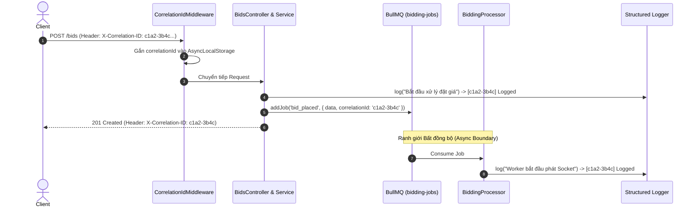
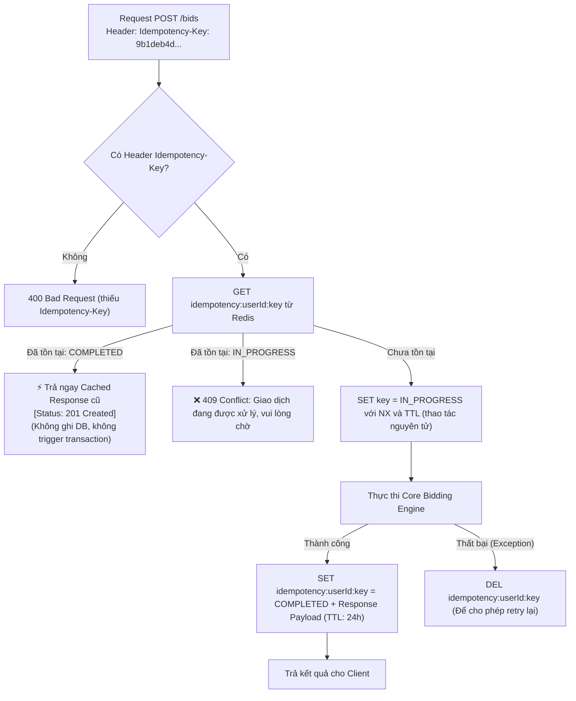
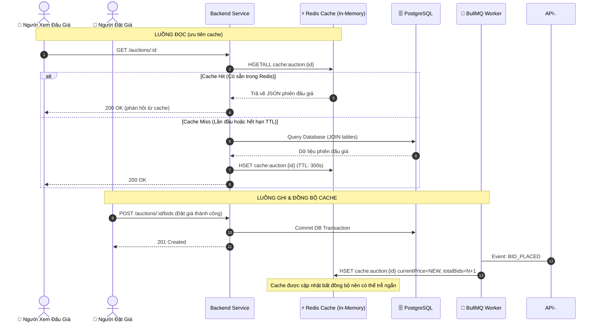
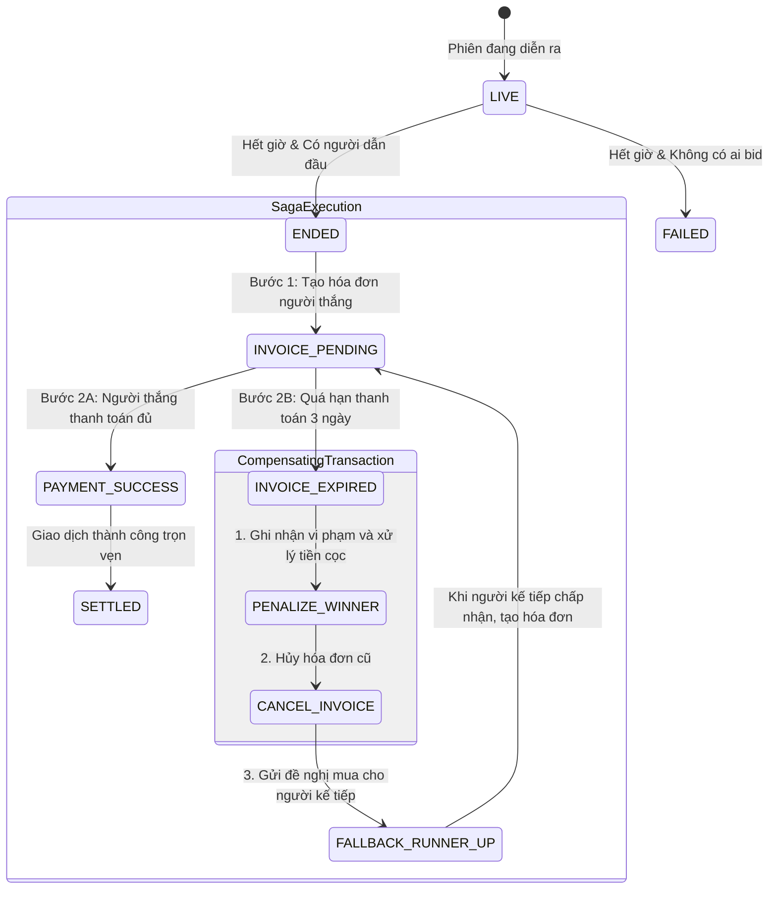

# Đề xuất kiến trúc nâng cao cho hệ thống đấu giá trực tuyến

*Phân tích năm giải pháp kiến trúc nhằm tăng độ tin cậy, khả năng mở rộng và khả năng quan sát của hệ thống*

Tài liệu đề xuất năm giải pháp kiến trúc cho **hệ thống đấu giá trực tuyến**: sử dụng mã tương quan để liên kết nhật ký, bảo đảm tính lũy đẳng của yêu cầu đặt giá, áp dụng Transactional Outbox để giảm nguy cơ mất sự kiện, tối ưu luồng đọc bằng CQRS kết hợp bộ nhớ đệm và tổ chức quy trình hậu đấu giá theo Saga. Mỗi giải pháp được trình bày theo ba nội dung: **WHAT (Khái niệm)**, **WHY (Lý do áp dụng)** và **HOW (Hướng triển khai)**.

**Phạm vi:** Tài liệu mô tả phương án thiết kế cho bài tập môn học, không phải báo cáo kết quả triển khai thực tế. Các con số về tải, thời gian phản hồi và thời gian thực hiện (nếu có) mang tính minh họa hoặc ước lượng, cần được kiểm chứng bằng thử nghiệm.

---

## 0. Tổng quan kiến trúc hệ thống

Sơ đồ sau thể hiện mối liên hệ giữa năm giải pháp, từ lúc người dùng gửi yêu cầu đặt giá, qua bước lưu giao dịch và xử lý sự kiện bất đồng bộ, đến quá trình chốt phiên và xử lý thanh toán:

```mermaid
flowchart TD
    Client["👤 Client (Web / Mobile)"] -->|1. HTTP POST /bids\n[Idempotency-Key & X-Correlation-ID]| Ingress["🛡️ Tầng Biên Giới (Ingress / API Gateway)"]

    subgraph Pillar12["Giải pháp 1 & 2: Quan Sát & An Toàn Giao Dịch"]
        Ingress --> TraceMW["📌 1. Tracing Middleware\n(Bắt/Tạo X-Correlation-ID & Gắn Async Context)"]
        TraceMW --> IdemGuard["🔑 2. Idempotency Interceptor\n(Kiểm tra Idempotency-Key trong Redis)"]
    end

    IdemGuard -->|"Key Đã Hoàn Thành"| CachedRes["⚡ Trả ngay Cached Response cũ\n(Không chạm DB, không sinh duplicate bid)"]
    IdemGuard -->|"Key Đang Xử Lý"| InFlight["⚠️ 409 Conflict: Request In-Flight"]
    IdemGuard -->|"Key Mới Hợp Lệ"| CoreEngine["⚡ Core Bidding Engine (luồng xử lý chính)"]

    subgraph Pillar3["Giải pháp 3: Transactional Outbox (Chống Dual-Write)"]
        CoreEngine --> SQLTx["🔒 1 SQL Transaction Duy Nhất (ACID)\n1. Cập nhật Auction (Optimistic Lock: version=v+1)\n2. Thêm bản ghi Bids (Append-only Ledger)\n3. Thêm bản ghi OUTBOX_EVENTS (Status: PENDING)"]
        SQLTx --> Commit["Commit PostgreSQL"]
    end

    Commit --> SaveIdem["Lưu Response vào Redis theo Idempotency-Key"]
    SaveIdem --> Res201["✅ Trả về 201 Created"]

    subgraph Pillar3B["Outbox Relay & Queue-based Load Leveling"]
        Commit -.-> OutboxWorker["👷 Outbox Relay Worker\n(Đọc OUTBOX_EVENTS PENDING)"]
        OutboxWorker --> PushBullMQ["Push Job vào Redis BullMQ\n(Kèm X-Correlation-ID)"]
        PushBullMQ --> MarkSent["Đánh dấu Outbox: PUBLISHED"]
        PushBullMQ --> BullMQWorker["👥 Competing Consumer Workers"]
    end

    subgraph Pillar4["Giải pháp 4: CQRS & Cache-Aside (Tối ưu luồng đọc)"]
        BullMQWorker --> UpdateCache["⚡ Cập nhật Redis Hash: cache:auction:{id}\n(Cập nhật dữ liệu hiển thị cho người xem)"]
        BullMQWorker --> WS["📡 Broadcast Socket.io Room & Outbid Alert"]
        
        Reader["👀 10.000 Khách Xem Giá"] --> ReadQuery["GET /auctions/:id"]
        ReadQuery --> ReadCache{"Có dữ liệu trong Redis?"}
        ReadCache -->|"Cache hit"| RedisRead["Phản hồi từ dữ liệu cache"]
        ReadCache -->|"Cache miss"| DBRead["Query PostgreSQL & Nạp lại Redis"]
    end

    subgraph Pillar5["Giải pháp 5: Saga Pattern (Quy Trình Hậu Đấu Giá & Bù Trừ)"]
        Scheduler["⏰ Hết Giờ Đấu Giá"] --> SettleSaga["📜 Settlement Saga Orchestrator"]
        SettleSaga --> Step1["Bước 1: Chốt phiên ENDED & Tạo Invoice"]
        Step1 --> Step2["Bước 2: Chờ Thanh Toán (Thời hạn 3 ngày)"]
        Step2 -->|"Thanh Toán Thành Công"| SagaComplete["✅ Giao Hàng & Hoàn Cọc Người Thua"]
        Step2 -->|"Quá hạn thanh toán"| CompensatingTx["🔄 Giao Dịch Bù Trừ (Compensating Transaction):\n1. Tịch thu tiền cọc người thắng (Phạt)\n2. Hủy hóa đơn (INVOICE_CANCELED)\n3. Mời người trả giá cao kế tiếp mua sản phẩm"]
    end
```

---

## 1. Giải pháp 1: Correlation ID và Distributed Tracing (Truy vết yêu cầu)

### 1.1. WHAT — Khái niệm
**Correlation ID** là mã dùng để liên kết các bản ghi nhật ký phát sinh từ cùng một yêu cầu, kể cả khi yêu cầu đi qua API, cơ sở dữ liệu, hàng đợi và worker xử lý nền. Đây là bước triển khai cơ bản để cải thiện khả năng quan sát. **Distributed Tracing** mở rộng cách tiếp cận này bằng việc ghi nhận các *span* và quan hệ giữa chúng, từ đó hỗ trợ phân tích thời gian xử lý theo từng chặng. Hai khái niệm có liên quan nhưng không hoàn toàn đồng nhất.

### 1.2. WHY — Lý do áp dụng
* **Bài toán thực tế:** Trong kiến trúc bất đồng bộ (Queue-based Load Leveling), khi người dùng gửi yêu cầu `POST /bids`, luồng HTTP có thể kết thúc trước khi các tác vụ nền hoàn tất. Sau đó, Worker của BullMQ tiếp tục nhận tác vụ để phát thông báo qua WebSocket hoặc hệ thống thông báo. 
* **Hậu quả nếu không có:** Khi người dùng khiếu nại *"Tôi đặt giá thành công nhưng 30 giây sau mới nhận được thông báo"*, nhóm phát triển sẽ khó liên kết nhật ký giữa HTTP request và worker, làm tăng thời gian tìm nguyên nhân sự cố.
* **Lợi ích kiến trúc:** 
  1. Cho phép liên kết toàn bộ dấu vết (Traces) của một giao dịch qua các ranh giới mạng và bất đồng bộ.
  2. Khi có thêm span và các mốc thời gian phù hợp, có thể phân tích độ trễ ở từng chặng như truy vấn cơ sở dữ liệu, chờ trong hàng đợi và phát thông báo.

### 1.3. HOW — Hướng triển khai

#### A. Cơ chế hoạt động
1. **NestJS Middleware (`CorrelationIdMiddleware`):** Đọc header `X-Correlation-ID` từ client (nếu được hệ thống tin cậy) hoặc tự tạo UUID mới.
2. **Context Storage:** Lưu mã này vào `AsyncLocalStorage` (Node.js native) để mọi Service, Repository hoặc Logger có thể truy xuất mà không cần truyền param thủ công qua từng hàm.
3. **Queue Enrichment:** Khi đẩy message vào BullMQ, tự động đóng gói `correlationId` vào metadata của Job.
4. **Định dạng nhật ký:** Sử dụng nhật ký có cấu trúc, chẳng hạn JSON với các trường `timestamp`, `correlationId`, `level`, `context` và `message`.

#### B. Sơ đồ tuần tự


---

## 2. Giải pháp 2: Idempotency Key (Ngăn xử lý trùng yêu cầu đặt giá)

### 2.1. WHAT — Khái niệm
**Idempotency (tính lũy đẳng)** là đặc tính giúp việc thực hiện lại cùng một yêu cầu không tạo thêm tác động nghiệp vụ ngoài lần xử lý đầu tiên. Trong hệ thống đấu giá, client có thể gửi `Idempotency-Key` để máy chủ nhận diện các lần thử lại của cùng một thao tác. Khi một yêu cầu đã hoàn tất, hệ thống có thể trả lại kết quả đã lưu thay vì tạo thêm lượt đặt giá.

### 2.2. WHY — Lý do áp dụng
* **Bài toán thực tế:** Kết nối mạng di động có thể bị gián đoạn. Người dùng nhấn "Đặt giá 50.000.000đ", server đã xử lý thành công và trừ cọc, nhưng trên đường truyền phản hồi chưa đến được thiết bị. Người dùng tiếp tục nhấn nút "Đặt giá" thêm một lần nữa.
* **Hậu quả nếu không có:** 
  1. Nếu không kiểm soát, request thứ hai có thể bị xem là một lượt đặt giá mới (tự nâng giá của chính mình lên 50.100.000đ).
  2. Hoặc request thứ hai gây ra lỗi `409 Conflict` khiến người dùng hoang mang tưởng rằng lượt đặt giá đầu tiên đã thất bại.
* **Mức độ phù hợp:** Cách tiếp cận này thường được sử dụng trong các API cần hạn chế tác dụng phụ khi client gửi lại yêu cầu, đặc biệt với thao tác đặt giá hoặc thanh toán.

### 2.3. HOW — Hướng triển khai

#### A. Trạng thái yêu cầu trong Redis
Key trong Redis: `idempotency:<userId>:<idempotencyKey>`
* **Trạng thái 1: `IN_PROGRESS` (TTL minh họa: 30 giây):** Đánh dấu yêu cầu đang được xử lý, hạn chế xử lý trùng khi có các yêu cầu đến đồng thời.
* **Trạng thái 2: `COMPLETED` (TTL minh họa: 24 giờ):** Lưu mã trạng thái HTTP và nội dung phản hồi của yêu cầu đã hoàn tất.

Bên cạnh khóa định danh, nên lưu dấu vân tay của nội dung yêu cầu để phát hiện trường hợp cùng `Idempotency-Key` nhưng khác dữ liệu. Việc tạo trạng thái `IN_PROGRESS` cần dùng thao tác nguyên tử (ví dụ `SET ... NX EX`), tránh tình trạng hai yêu cầu đồng thời cùng vượt qua bước kiểm tra.

#### B. Lưu đồ xử lý


---

## 3. Giải pháp 3: Transactional Outbox (Giảm rủi ro mất sự kiện khi ghi dữ liệu)

### 3.1. WHAT — Khái niệm
**Transactional Outbox** là mẫu kiến trúc giúp tránh tình huống dữ liệu nghiệp vụ đã được lưu nhưng sự kiện tương ứng chưa được đưa vào hàng đợi. Thay vì ghi trực tiếp vào cơ sở dữ liệu và hàng đợi trong cùng luồng xử lý, hệ thống ghi dữ liệu nghiệp vụ cùng bản ghi sự kiện trong bảng `outbox_events` bằng một giao dịch PostgreSQL. Worker nền sau đó đọc các bản ghi này và chuyển sự kiện sang BullMQ.

### 3.2. WHY — Lý do áp dụng
* **Lỗ hổng "Dual-Write Problem":**
  Trong code thông thường:
  ```ts
  await dbTransaction.commit(); // Bước 1: Lưu vào DB
  await redisQueue.addJob();    // Bước 2: Gửi vào Redis Queue
  ```
  Nếu server bị sập nguồn, container bị OOM Kill, hoặc mạng giữa backend và Redis bị đứt **giữa bước 1 và bước 2**:
  * Bản ghi đặt giá đã được lưu trong PostgreSQL.
  * Nhưng tác vụ tương ứng chưa được gửi vào BullMQ.
  * **Hậu quả:** Sự kiện đặt giá có thể không được phát đến các thành phần liên quan nếu hệ thống không có cơ chế khôi phục.
* **Giải pháp:** Bảng `bids` và `outbox_events` nằm trong cùng cơ sở dữ liệu và được ghi trong một giao dịch. Nhờ tính nguyên tử (Atomicity), dữ liệu nghiệp vụ và sự kiện được lưu cùng nhau hoặc cùng bị hoàn tác.

### 3.3. HOW — Hướng triển khai

#### A. Thiết kế bảng `outbox_events`
```sql
CREATE TABLE outbox_events (
    id UUID PRIMARY KEY DEFAULT gen_random_uuid(),
    aggregate_type VARCHAR(64) NOT NULL, -- 'AUCTION'
    aggregate_id UUID NOT NULL,          -- auctionId
    event_type VARCHAR(64) NOT NULL,     -- 'BID_PLACED', 'AUCTION_ENDED'
    payload JSONB NOT NULL,              -- Chi tiết dữ liệu sự kiện
    status VARCHAR(20) DEFAULT 'PENDING',-- 'PENDING', 'PUBLISHED', 'FAILED'
    retry_count INT DEFAULT 0,
    created_at TIMESTAMP DEFAULT NOW(),
    processed_at TIMESTAMP
);
CREATE INDEX idx_outbox_pending ON outbox_events(status, created_at) WHERE status = 'PENDING';
```

#### B. Luồng xử lý hai giai đoạn
1. **Tầng 1 (Synchronous Hot Path - Ghi đồng bộ):**
   ```ts
   await dataSource.transaction(async (manager) => {
     // 1. Cập nhật Auction với Optimistic Lock
     await manager.update(Auction, ...);
     // 2. Thêm bản ghi Bid
     await manager.save(Bid, ...);
     // 3. Ghi Outbox Event (Cùng transaction!)
     await manager.save(OutboxEvent, {
       aggregateType: 'AUCTION',
       aggregateId: auctionId,
       eventType: 'BID_PLACED',
       payload: { auctionId, amount, bidderName, ... },
       status: 'PENDING'
     });
   });
   // Sau khi giao dịch hoàn tất, API có thể trả kết quả cho client.
   ```
2. **Tầng 2 (Asynchronous Poller / Publisher - Xử lý nền):**
   * Một Scheduled Worker (`OutboxPublisherWorker`) quét bảng `outbox_events` với `status = 'PENDING'` (sử dụng câu lệnh `FOR UPDATE SKIP LOCKED` để nhiều worker có thể chạy song song mà không tranh chấp).
   * Đẩy dữ liệu vào BullMQ.
   * Cập nhật trạng thái `status = 'PUBLISHED'` và `processed_at = NOW()`.
   * **Đặc điểm:** Khi có cơ chế quét lại và thử gửi lại, sự kiện có thể được phát theo mô hình **at-least-once**. Vì có khả năng nhận trùng, worker tiêu thụ cần có cơ chế xử lý trùng lặp.

---

## 4. Giải pháp 4: CQRS và Cache-Aside (Tối ưu luồng đọc dữ liệu)

### 4.1. WHAT — Khái niệm
**CQRS (Command Query Responsibility Segregation)** là cách tổ chức tách biệt phần xử lý lệnh thay đổi dữ liệu (command) và phần truy vấn dữ liệu (query). Với **Cache-Aside**, API ưu tiên lấy dữ liệu hiển thị từ Redis; khi cache chưa có dữ liệu, hệ thống truy vấn PostgreSQL rồi đưa kết quả vào cache để phục vụ các lượt đọc tiếp theo.

### 4.2. WHY — Lý do áp dụng
* **Đặc thù tải của hệ thống đấu giá:** 
  * Lượt xem thông tin phiên đấu giá thường nhiều hơn lượt đặt giá. Ví dụ, một phiên có nhiều người theo dõi liên tục nhưng chỉ một phần nhỏ người dùng thực hiện thao tác đặt giá.
* **Hậu quả nếu không có:** Nếu mọi lượt xem đều thực hiện truy vấn phức tạp trên PostgreSQL, tải đọc tăng cao có thể ảnh hưởng đến tài nguyên cơ sở dữ liệu và độ trễ của thao tác đặt giá.
* **Hiệu quả kỳ vọng:** Giảm số lượt truy vấn đến PostgreSQL và cải thiện tốc độ lấy dữ liệu ở những trường hợp cache hit. Mức cải thiện cụ thể cần đo bằng thử nghiệm tải.

### 4.3. HOW — Hướng triển khai

#### A. Tách luồng ghi và luồng đọc
* **Command Model (Ghi):** `POST /bids` $\rightarrow$ Đi vào PostgreSQL (Single Source of Truth) qua giao dịch ACID.
* **Query Model (Đọc):** `GET /auctions/:id` $\rightarrow$ Đi vào Redis Hash Key `cache:auction:{id}`.

#### B. Sơ đồ cập nhật và nạp dữ liệu cache


---

## 5. Giải pháp 5: Saga (Điều phối thanh toán và xử lý vi phạm sau đấu giá)

### 5.1. WHAT — Khái niệm
**Saga Pattern** hỗ trợ điều phối quy trình nghiệp vụ gồm nhiều bước và có thể kéo dài qua nhiều thời điểm. Thay vì giữ một giao dịch cơ sở dữ liệu trong toàn bộ thời gian chờ thanh toán, hệ thống thực hiện từng bước bằng giao dịch cục bộ. Khi phát sinh lỗi hoặc hết thời hạn thanh toán, Saga kích hoạt các bước xử lý bù trừ hoặc chuyển trạng thái theo quy tắc nghiệp vụ. Những bước này không nhất thiết đảo ngược hoàn toàn mọi tác động đã xảy ra.

### 5.2. WHY — Lý do áp dụng
* **Nghiệp vụ sau khi kết thúc phiên đấu giá:**
  1. Tạo Hóa đơn thanh toán (`Invoice`).
  2. Tạm giữ tiền đặt cọc (Deposit) của người thắng cuộc.
  3. Hoàn trả tiền đặt cọc lại cho toàn bộ những người tham gia bị thua cuộc.
  4. Người thắng cuộc có **3 ngày** để thanh toán số tiền còn lại.
* **Hậu quả nếu không có Saga:**
  Không phù hợp nếu duy trì một giao dịch cơ sở dữ liệu trong suốt thời gian chờ thanh toán. Khi người thắng không thanh toán đúng hạn, hệ thống cần xử lý các vấn đề sau:
  * Tịch thu tiền đặt cọc làm phí phạt?
  * Khóa tài khoản gian lận?
  * Hủy hóa đơn cũ?
  * **Đặc biệt:** Gửi đề nghị mua cho **người trả giá cao kế tiếp (runner-up)** theo chính sách đấu giá, nếu người này còn đủ điều kiện và đồng ý?
* **Giá trị mang lại:** Giúp quy trình hậu đấu giá có trạng thái rõ ràng, dễ theo dõi và giảm thao tác xử lý thủ công khi phát sinh vi phạm thanh toán.

### 5.3. HOW — Hướng triển khai

#### A. Sơ đồ chuyển trạng thái


#### B. Quy trình xử lý khi quá hạn
Khi Cron Job phát hiện hóa đơn quá `dueDate` mà vẫn ở trạng thái `PENDING`:
1. **Giao dịch cục bộ 1 (Xử lý vi phạm):**
   * Đánh dấu trạng thái vi phạm của tài khoản; việc khóa tài khoản cần căn cứ chính sách của hệ thống.
   * Cập nhật lịch sử uy tín của người dùng theo quy tắc được xác định trước.
   * Chuyển trạng thái hóa đơn sang `CANCELED`.
2. **Giao dịch cục bộ 2 (Mời người trả giá cao kế tiếp):**
   * Truy vấn bảng `BIDS`: Xác định người trả giá hợp lệ cao kế tiếp (runner-up), không chỉ đơn thuần chọn bản ghi có giá cao thứ hai.
   * Nếu tìm thấy Á quân:
     * Sau khi người được mời chấp nhận, cập nhật `Auction.highestBidderId = runnerUp.bidderId`.
     * Cập nhật `Auction.currentPrice = runnerUp.amount` theo quy tắc giá bán của hệ thống.
     * Tạo `Invoice` mới cho người chấp nhận đề nghị, với thời hạn thanh toán theo quy định.
     * Phát sự kiện thông báo: *"Người trúng đấu giá trước đó không hoàn tất thanh toán. Bạn được mời mua sản phẩm theo quy định của phiên đấu giá. Vui lòng xác nhận nếu đồng ý."*.
   * Nếu không có ai khác: Chuyển trạng thái phiên sang `FAILED`.

---

## 6. Ma trận tham khảo tác động đến thuộc tính chất lượng

Bảng dưới đây minh họa mức độ đóng góp tương đối của từng giải pháp đối với một số thuộc tính chất lượng. Đây là nhận định định tính của nhóm, **không phải điểm số do ISO/IEC 25010 quy định**:

| Mẫu Kiến Trúc (Architectural Pattern) | Tính Toàn Vẹn Dữ Liệu (Integrity) | Tính Sẵn Sàng (Availability) | Hiệu Năng & Thông Lượng (Performance) | Khả Năng Quan Sát (Observability) | Khả Năng Chống Lỗi (Fault Tolerance) |
|---|:---:|:---:|:---:|:---:|:---:|
| **1. Distributed Tracing** | | | | ⭐⭐⭐⭐⭐ | ⭐⭐⭐⭐ |
| **2. Idempotency Keys** | ⭐⭐⭐⭐⭐ | ⭐⭐⭐⭐ | ⭐⭐⭐⭐ | | ⭐⭐⭐⭐⭐ |
| **3. Transactional Outbox** | ⭐⭐⭐⭐⭐ | ⭐⭐⭐⭐⭐ | ⭐⭐⭐⭐ | ⭐⭐⭐ | ⭐⭐⭐⭐⭐ |
| **4. CQRS & Cache-Aside** | ⭐⭐⭐ | ⭐⭐⭐⭐⭐ | ⭐⭐⭐⭐⭐ | | ⭐⭐⭐⭐ |
| **5. Post-Auction Saga** | ⭐⭐⭐⭐⭐ | ⭐⭐⭐⭐ | ⭐⭐⭐ | ⭐⭐⭐⭐ | ⭐⭐⭐⭐⭐ |

---

## 7. Kế hoạch triển khai thử nghiệm

| Giai đoạn | Nội dung thực hiện | Mức độ phức tạp | Thời gian tham khảo* |
|---|---|---|---|
| **Pha 1: Truy vết và chống trùng lặp** | Xây dựng `CorrelationIdMiddleware`, `IdempotencyInterceptor` và thử nghiệm gửi trùng yêu cầu | Trung bình | 1–2 buổi |
| **Pha 2: Tối ưu luồng đọc** | Bổ sung Cache-Aside cho `GET /auctions/:id`, đo thời gian phản hồi khi hit/miss | Trung bình | 1 buổi |
| **Pha 3: Transactional Outbox** | Thêm bảng `outbox_events`, ghi dữ liệu trong một giao dịch, xây dựng worker phát sự kiện | Trung bình–khó | 1–2 buổi |
| **Pha 4: Quy trình Saga** | Bổ sung xử lý hóa đơn quá hạn, ghi nhận vi phạm và gửi lời mời người kế tiếp | Khó | 1–2 buổi |


*Thời gian chỉ là ước lượng cho một bản minh họa hoặc nguyên mẫu đơn giản, chưa tính tích hợp, kiểm thử đầy đủ và sửa lỗi.*

---

## 8. Kiểm thử và giới hạn đề xuất

Để phần đề xuất có tính thuyết phục hơn trong phạm vi bài tập, có thể bổ sung một số tình huống kiểm thử ngắn:

1. **Gửi trùng yêu cầu:** Hai request cùng `Idempotency-Key` đến gần như đồng thời; chỉ một lượt đặt giá được ghi nhận.
2. **Gián đoạn khi phát sự kiện:** Worker dừng sau khi giao dịch PostgreSQL hoàn tất; sự kiện vẫn được phát khi worker hoạt động trở lại, và consumer xử lý được trường hợp trùng lặp.
3. **Cache miss và cập nhật chậm:** API đọc dữ liệu từ PostgreSQL khi Redis chưa có cache; ghi nhận độ trễ giữa lúc bid được chấp nhận và khi cache được cập nhật.
4. **Thanh toán quá hạn:** Hóa đơn chuyển sang trạng thái quá hạn, lưu lịch sử xử lý và gửi đề nghị mua cho người hợp lệ tiếp theo theo chính sách đã định.
5. **Liên kết nhật ký:** Một yêu cầu đặt giá có thể được tra cứu xuyên suốt API và worker bằng `correlationId`.

**Lưu ý về giới hạn:** Tài liệu tập trung vào kiến trúc đề xuất. Những thông số hiệu năng hoặc độ sẵn sàng chỉ nên được khẳng định là kết quả đạt được sau khi có số liệu đo kiểm.

---

## 9. Kết luận

Năm giải pháp đề xuất xử lý các khía cạnh bổ trợ nhau của hệ thống đấu giá: truy vết sự cố, tránh ghi nhận trùng lượt đặt giá, phát sự kiện tin cậy, đáp ứng nhiều lượt xem và điều phối thanh toán sau phiên. Trong phạm vi bài tập, nhóm nên ưu tiên xây dựng một luồng minh họa hoàn chỉnh và kiểm thử các trường hợp lỗi tiêu biểu thay vì triển khai toàn bộ tính năng ở mức sản phẩm thực tế. Cần lưu ý rằng một số thành phần hoạt động bất đồng bộ nên dữ liệu hiển thị có thể cập nhật chậm trong khoảng thời gian ngắn.

*Trước khi nộp: bổ sung tài liệu tham khảo cho các kỹ thuật được sử dụng (ví dụ tài liệu chính thức của Node.js, Redis, BullMQ và PostgreSQL), đồng thời ghi rõ các giả định của bài toán và kết quả đo kiểm nếu có.*
