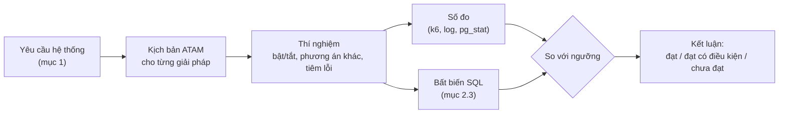

# Kế hoạch đánh giá kiến trúc hệ thống đấu giá trực tuyến

*Đo xem năm giải pháp trong [archtecture_specific.md](archtecture_specific.md) tốt đến mức nào, vì sao, và có phải lựa chọn đúng so với phương án khác*

Tài liệu mô tả cách đánh giá: yêu cầu để so, kịch bản cho từng giải pháp, ngưỡng đạt, phương án đem ra so sánh, và phân công cho ba thành viên. Mỗi kịch bản viết theo dạng kịch bản thuộc tính chất lượng (ATAM): **kích thích → môi trường → phản hồi phải đo được → ngưỡng**.

**Phạm vi:** đây là kế hoạch, chưa có số đo nào. Mọi mục "Dự đoán" là giả thuyết viết ra trước khi đo để có thể bị bác bỏ; mục nào dựa trên việc đọc code đều ghi rõ. Việc tổng hợp số liệu thành báo cáo cuối và việc sửa các lỗi tìm thấy nằm ngoài tài liệu này.

---

## 0. Tổng quan phương pháp

Một giải pháp được kết luận là tốt khi trả lời được bốn câu hỏi bằng số đo:

1. **Có cần không?** Tắt nó đi thì kịch bản hỏng ở đâu.
2. **Có chọn đúng không?** So với ít nhất một phương án khác giải cùng vấn đề.
3. **Tốn gì?** Độ trễ thêm, phụ thuộc thêm, giới hạn thông lượng.
4. **Gãy ở đâu?** Điều kiện nào thì lời hứa của nó không còn đúng.

---

## 1. Yêu cầu hệ thống dùng làm ngưỡng

| Mã | Yêu cầu | Giá trị |
|---|---|---|
| R1 | Số người xem đồng thời một phiên | 1.000 |
| R2 | Số yêu cầu đặt giá gửi tới một phiên nóng | 20 yêu cầu/giây |
| R3 | Độ trễ đọc chi tiết phiên (p95) | dưới 100 ms |
| R4 | Độ trễ đặt giá (p95) | dưới 300 ms |
| R5 | Tỉ lệ lỗi | dưới 1% |

Con số 1.000 người xem là mức thu nhỏ từ 10.000 trong tài liệu kiến trúc cho vừa một máy laptop. Hai cách hiểu sau cần nhóm xác nhận (mục 11):

- **R2** là số yêu cầu gửi tới, không phải số bid thành công. Số thành công là thứ kịch bản K0 phải đo.
- **R5** chỉ tính lỗi 5xx và timeout. Các mã 409 và 400 do luật nghiệp vụ được đếm riêng.

---

## 2. Quy ước chung cho mọi thí nghiệm

### 2.1. Môi trường đo

- Chạy bằng `eval/docker-compose.eval.yml`, build target `prod`, giới hạn tài nguyên cố định cho từng container để các lần chạy so được với nhau.
- Máy sinh tải chạy cùng máy với hệ thống. Vì vậy số tuyệt đối chỉ đúng cho cấu hình này; số so sánh giữa hai phương án mới là kết quả chính.
- Trước mỗi lần chạy: xóa dữ liệu (`down -v`), nạp dữ liệu tải, chạy khởi động 30 giây không tính số.
- Mỗi thí nghiệm chạy ít nhất 3 lần; ghi trung vị, giá trị nhỏ nhất và lớn nhất.

### 2.2. Cờ cấu hình cần thêm vào code

Giá trị mặc định của mọi cờ giữ nguyên hành vi hiện tại.

| Cờ | Tác dụng | File | Người thêm |
|---|---|---|---|
| `BID_LOCK_MODE=optimistic\|pessimistic` | Đổi giữa kiểm tra `version` và `SELECT ... FOR UPDATE` trên hàng `auctions` | `bids.service.ts` | introvertkid |
| `IDEMPOTENCY_ENABLED` | Tắt `IdempotencyInterceptor` | `idempotency.interceptor.ts` | introvertkid |
| `EVENT_PUBLISH_MODE=outbox\|direct` | `direct`: gọi `queue.add` ngay sau commit, không ghi outbox; lỗi publish chỉ ghi log, vẫn trả 201 | `bids.service.ts` | introvertkid |
| `CACHE_ENABLED` | Tắt đọc và ghi cache, luôn đọc Postgres | `auctions.service.ts` | introvertkid |
| `CRASH_POINT=after_bid_commit` | Process thoát đúng sau commit bid, trước khi publish và trước khi lưu kết quả idempotency | `bids.service.ts` | introvertkid |
| `EVAL_WORKER_DELAY_MS` | Worker ngủ thêm trước khi xử lý job | `auction-events.processor.ts` | introvertkid |
| Ghi nhận job đã xử lý | Worker ghi `bidId` của mỗi job vào bảng `eval_processed_events` | `auction-events.processor.ts` | introvertkid |
| `INVOICE_DUE_MS`, `OFFER_TTL_MS`, `SETTLEMENT_POLL_MS` | Rút thời hạn 3 ngày, 24 giờ và chu kỳ quét của Saga | `settlements.service.ts` | MINH TRUONG |
| `CRASH_POINT=saga_before_commit` | Process thoát sau khi phát thông báo realtime, trước khi commit bước Saga | `settlements.service.ts` | MINH TRUONG |

### 2.3. Bất biến kiểm tra sau mỗi lần chạy

Viết thành `eval/sql/invariants.sql`. Mỗi bất biến trả về số hàng vi phạm; kỳ vọng luôn bằng 0.

| Mã | Bất biến |
|---|---|
| I1 | Mỗi phiên có tối đa một bid ở trạng thái `VALID` |
| I2 | Với phiên có bid: giá hiện tại bằng bid lớn nhất, người dẫn đầu là chủ của bid đó |
| I3 | Số bid trong DB bằng số response 201 mà máy sinh tải ghi nhận (không tính response có header `Idempotent-Replayed`) |
| I4 | Mỗi bid có đúng một sự kiện outbox `BID_PLACED`; không sự kiện nào thiếu bid |
| I5 | Sau khi dừng tải 5 giây: không còn outbox `PENDING`; `version` trong cache bằng `version` trong DB |
| I6 | Saga: mỗi phiên đã hết giờ ở đúng một trạng thái cuối; mỗi phiên có tối đa một hóa đơn `PENDING` và một offer `PENDING`; không có cặp (hóa đơn `PAID`, cọc `FORFEITED`) của cùng người và cùng phiên; cọc của người thua không còn `HELD` |

### 2.4. Quy tắc kết luận

| Mức | Điều kiện |
|---|---|
| **Đạt** | Mọi ngưỡng của kịch bản đều đạt, chi phí nằm trong trần đã ghi |
| **Đạt có điều kiện** | Ngưỡng chính đạt, nhưng có một kịch bản giới hạn không đạt hoặc chi phí vượt trần. Phải ghi rõ điều kiện |
| **Chưa đạt** | Ngưỡng chính không đạt, hoặc có vi phạm bất biến |

Mỗi giải pháp có thêm một câu kết luận riêng: nó hơn, bằng hay kém phương án đem ra so sánh, theo số đo nào.

### 2.5. Ghi kết quả

Mỗi kịch bản một file `eval/results/<mã kịch bản>.md` gồm: cấu hình đã chạy, bảng số đo từng lần chạy, kết quả bất biến, dự đoán đúng hay sai, kết luận theo mục 2.4.

---

## 3. K0: Tranh chấp khóa khi nhiều người đặt giá cùng lúc

Đây không thuộc năm giải pháp nhưng là nền của luồng đặt giá và là câu dễ bị hỏi nhất: vì sao dùng optimistic lock mà không dùng `SELECT FOR UPDATE`.

### 3.1. Tuyên bố cần kiểm chứng
Optimistic lock bảo đảm tính đúng khi tranh chấp mà không giữ khóa DB, và ở mức tải yêu cầu nó không từ chối oan quá nhiều lượt bid hợp lệ.

### 3.2. Vì sao phép thử "đúng một người thắng" không đủ
Khi xung đột, hệ thống trả 409 ngay và không thử lại (`bids.service.ts:93`). Vì vậy "đúng một người thắng" chắc chắn qua và không nói lên điều gì. Thứ cần đo là bao nhiêu lượt bị từ chối, và người trả cao nhất có thắng hay không.

### 3.3. Kịch bản

| Mã | Kích thích và môi trường | Thước đo | Ngưỡng đạt |
|---|---|---|---|
| K0a | 20 yêu cầu bid/giây trong 60 giây vào một phiên, trong lúc có 1.000 người xem. Mỗi bidder đọc giá rồi đặt giá hiện tại cộng 1–3 bước giá | Tỉ lệ 409; số bid thành công mỗi giây; p95 | 409 không quá 10%; p95 dưới 300 ms; I1, I2 không vi phạm |
| K0b | 50 bidder gửi cùng lúc, mỗi người một mức giá khác nhau (giá hiện tại cộng k bước giá, k từ 1 đến 50), thứ tự ngẫu nhiên. Lặp 100 lần | Số bid thành công mỗi đợt; tỉ lệ đợt mà bid cao nhất được ghi nhận; p95 và p99 | I1, I2 không vi phạm; tỉ lệ đợt mà bid cao nhất thắng: ghi nhận, không đặt ngưỡng |

Mức giá phải khác nhau. Nếu 50 người cùng đặt một giá thì chỉ một người thắng với bất kỳ kiểu khóa nào, và phép so không cho thấy gì.

### 3.4. Phương án so sánh

| Phương án | Cách có |
|---|---|
| A. Optimistic lock (hiện tại) | `BID_LOCK_MODE=optimistic` |
| B. `SELECT ... FOR UPDATE` trên hàng `auctions` | `BID_LOCK_MODE=pessimistic` |

### 3.5. Dự đoán
- **K0b, phương án A:** mỗi đợt đúng 1 bid thành công, 49 lượt nhận 409. Bid thắng là bid commit trước, nên bid cao nhất chỉ thắng khoảng 2% số đợt.
- **K0b, phương án B:** các lượt xếp hàng chờ khóa. Lượt nào đến khi giá của nó vẫn cao hơn giá hiện tại thì thành công, nên mỗi đợt có khoảng 4–5 bid thành công (số kỷ lục trong một hoán vị ngẫu nhiên của 50 phần tử là H₅₀ ≈ 4,5). Bid cao nhất luôn thắng. Các lượt còn lại nhận 400 vì giá thấp hơn mức tối thiểu, không phải 409.
- **K0a:** ở 20 yêu cầu/giây, phương án A có tỉ lệ 409 khoảng 10–30%. Phương án B không có 409 nhưng p95 cao hơn.

### 3.6. Chi phí phải đo
- Phương án B giữ một kết nối DB trong lúc chờ khóa. Đo số kết nối đang dùng so với kích thước pool và p99 khi có 1.000 người xem cùng đọc.
- Phương án A đẩy việc thử lại cho client. Đo số lần thử trung bình để một bidder đặt được giá khi client tự thử lại sau 409.

### 3.7. Kết luận
Theo mục 2.4, cộng thêm: phương án nào cho p95 thấp hơn ở K0a, và phương án nào bảo đảm người trả cao nhất thắng ở K0b.

---

## 4. GP1: Correlation ID

### 4.1. Tuyên bố cần kiểm chứng
Với một khiếu nại cụ thể, người vận hành lần được toàn bộ đường đi của yêu cầu qua API, outbox và worker bằng một mã duy nhất.

### 4.2. Vì sao không đo tải
Overhead của việc gắn ID vào log là nhiễu so với các phép đo khác. Giá trị của GP1 nằm ở thời gian chẩn đoán, nên chỉ cần một kịch bản chẩn đoán và một lần kiểm phủ.

### 4.3. Kịch bản

| Mã | Kích thích và môi trường | Thước đo | Ngưỡng đạt |
|---|---|---|---|
| G1a | Đặt `EVAL_WORKER_DELAY_MS=30000` cho một phần job, tải 5 bid/giây. Người chẩn đoán chỉ biết: người dùng nào, lúc mấy giờ, "đặt giá xong 30 giây sau mới thấy cập nhật". Người này không được biết độ trễ chèn ở đâu | Thời gian và số bước để chỉ ra chặng gây trễ, khi có ID và khi không có ID (lần theo thời gian và `auctionId`) | Có ID: chỉ ra đúng chặng trong 5 phút |
| G1b | Đặt một bid, đọc log. Lập bảng mọi chặng của luồng bid và luồng Saga, đánh dấu chặng nào có dòng log mang ID | Số chặng có log mang ID trên tổng số chặng | Mọi chặng của luồng bid có ít nhất một dòng log mang ID |

G1a cần một thành viên khác làm người chẩn đoán trong khoảng 15 phút.

### 4.4. Phương án so sánh
Distributed tracing bằng OpenTelemetry, chỉ lập luận: nó ghi thêm span và thời gian từng chặng nên trả lời được "chặng nào mất 30 giây" mà không cần đọc log, đổi lại phải dựng thêm bộ thu và lưu trace.

### 4.5. Dự đoán
- G1a: có ID thì khoanh được khoảng "từ lúc commit đến lúc worker xử lý" trong vài phút.
- G1b không đạt hoàn toàn (đọc code, chưa chạy): relay chỉ ghi log khi lỗi, nên chặng outbox không có dòng log nào mang ID khi mọi thứ bình thường; ba cron của Saga không mang ID.
- Kết luận dự kiến: đạt có điều kiện.

---

## 5. GP2: Idempotency Key

### 5.1. Tuyên bố cần kiểm chứng
Khi client gửi lại một bid đã thành công, nó nhận lại đúng response 201 ban đầu thay vì một lỗi khó hiểu.

### 5.2. Vì sao không dùng "số bid trùng" làm thước đo
Tắt idempotency thì lượt gửi lại vẫn không tạo bid thứ hai: nếu người đó còn dẫn đầu thì bị chặn ở `bids.service.ts:59`, nếu đã bị vượt thì bị chặn vì giá thấp hơn mức tối thiểu ở `bids.service.ts:65`. Số bid trùng bằng 0 ở cả hai trường hợp. Thứ GP2 thật sự thêm vào là response trả về cho client.

### 5.3. Kịch bản

| Mã | Kích thích và môi trường | Thước đo | Ngưỡng đạt |
|---|---|---|---|
| G2a | Client gửi bid, nhận 201, gửi lại nguyên yêu cầu đó (mô phỏng mất response). 200 lần × {bật, tắt} | Tỉ lệ lượt gửi lại nhận 201 với nội dung trùng lần đầu; số bid trùng | Bật: 100% |
| G2b | 10 yêu cầu cùng key gửi đồng thời. 100 lần × {bật, tắt} | Phân bố mã trả về; số 5xx; số bid tạo ra | Bật: đúng 1 bid, còn lại là 201 phát lại hoặc 409; không có 5xx |
| G2c | Gửi lại cùng key với số tiền khác. 100 lần | Tỉ lệ nhận 422 | 100% |
| G2d | `CRASH_POINT=after_bid_commit`, backend tự khởi động lại, client gửi lại cùng key sau 5 giây và sau 40 giây. 50 lần | Mã trả về của lượt gửi lại | 201 với nội dung đúng |
| G2e | Dừng Redis 10 giây trong lúc có 20 yêu cầu bid/giây × {bật, tắt} | Tỉ lệ yêu cầu bid thất bại trong 10 giây đó | Ghi nhận, không đặt ngưỡng |

### 5.4. Phương án so sánh
Lưu key trong Postgres cùng transaction với bid (ràng buộc duy nhất trên cặp người đặt và key), chỉ lập luận: phương án này đóng được lỗ hổng ở G2d vì key và bid cùng commit hoặc cùng rollback, và không phụ thuộc Redis; đổi lại mỗi bid thêm một lần ghi DB.

### 5.5. Dự đoán
- G2a: bật 100%; tắt 0%, mọi lượt gửi lại nhận 400 "Bạn đang là người trả giá cao nhất". Số bid trùng bằng 0 ở cả hai.
- G2d không đạt (đọc code, chưa chạy): sau 5 giây nhận 409 vì key còn ở trạng thái đang xử lý; sau 40 giây key đã hết hạn, handler chạy lại và trả 400.
- G2e: bật thì gần 100% yêu cầu bid thất bại trong lúc Redis chết; tắt thì bid vẫn ghi được vào DB.

### 5.6. Chi phí phải đo
- Độ trễ thêm của bid khi bật so với khi tắt ở 20 yêu cầu/giây (hai lượt gọi Redis). Trần: p95 thêm không quá 10 ms.
- G2e đo cái giá về tính sẵn sàng: GP2 biến Redis thành phụ thuộc bắt buộc của luồng ghi.

### 5.7. Kết luận dự kiến
Đạt có điều kiện: giải đúng vấn đề response ở trường hợp thường gặp, gãy khi process chết sau commit, và làm luồng ghi phụ thuộc Redis.

---

## 6. GP3: Transactional Outbox

### 6.1. Tuyên bố cần kiểm chứng
Mọi bid đã commit đều có sự kiện tới được worker, kể cả khi process hoặc Redis chết giữa chừng.

### 6.2. Đo ở đâu
Outbox chỉ bảo đảm chặng từ DB đến worker. Chặng từ worker qua socket đến trình duyệt không thuộc lời hứa của nó và được đo riêng ở mục 9. Thước đo chính dùng được cho cả hai phương án:

- **Số sự kiện mất** = số bid đã commit trừ số `bidId` phân biệt trong `eval_processed_events`.
- **Số sự kiện trùng** = số hàng trong `eval_processed_events` trừ số `bidId` phân biệt.

### 6.3. Kịch bản

| Mã | Kích thích và môi trường | Thước đo | Ngưỡng đạt |
|---|---|---|---|
| G3a | `CRASH_POINT=after_bid_commit`, backend tự khởi động lại. 100 lần × {outbox, direct} | Số sự kiện mất; thời gian từ lúc backend sẵn sàng lại đến lúc worker xử lý xong sự kiện | Outbox: mất 0; worker xử lý trong 1 giây |
| G3b | Dừng Redis 10 giây trong lúc có 20 yêu cầu bid/giây, rồi bật lại. 5 lần × {outbox, direct}. Tắt GP2 trong thí nghiệm này | Số sự kiện mất; số trùng; thời gian phát bù hết sau khi Redis trở lại | Outbox: mất 0; phát bù xong trong 5 giây; I5 không vi phạm |

G3b phải tắt GP2: nếu để bật thì bid không vào được DB khi Redis chết (xem G2e) và không còn gì để mất.

### 6.4. Phương án so sánh

| Phương án | Cách có |
|---|---|
| A. Outbox quét định kỳ (hiện tại) | `EVENT_PUBLISH_MODE=outbox` |
| B. Publish trực tiếp sau commit | `EVENT_PUBLISH_MODE=direct` |
| C. CDC bằng Debezium | Chỉ lập luận: đọc WAL nên không cần quét và độ trễ thấp hơn, đổi lại phải vận hành thêm Kafka Connect; quá nặng so với quy mô này |

### 6.5. Dự đoán
- G3a: phương án B mất 100/100, phương án A mất 0/100. Con số 100/100 đúng do cách dựng thí nghiệm; nó chứng minh lỗ hổng tồn tại, không nói lỗ hổng xảy ra thường xuyên đến đâu.
- G3b: phương án B mất khoảng 200 sự kiện mỗi lần (20 bid/giây × 10 giây); phương án A mất 0. Đây là con số đo mức mất mát dưới một sự cố thực tế.
- Số trùng ở phương án A lớn hơn 0 nhưng vô hại, vì cache chỉ cập nhật khi `version` mới hơn.

### 6.6. Chi phí phải đo

| Chi phí | Cách đo | Trần |
|---|---|---|
| Độ trễ từ commit đến lúc worker nhận, ở 20 bid/giây, cả hai phương án | Chênh lệch thời điểm commit và thời điểm ghi `eval_processed_events` | p95 không quá 500 ms |
| Thông lượng tối đa của relay | Chèn sẵn 10.000 hàng `PENDING`, đo số sự kiện relay đẩy được mỗi giây và thời gian giữ transaction mỗi vòng | Ít nhất 100 sự kiện/giây (gấp 5 lần R2) |
| Tải nền lên DB khi không có bid | Số query mỗi giây của relay | Ghi nhận |
| Bảng outbox phình | Số hàng sau 30 phút chạy dài | Ghi nhận |

Dự đoán: độ trễ của phương án A có p50 khoảng 100 ms và p95 khoảng 250 ms do chu kỳ quét 200 ms; phương án B dưới 10 ms. Relay gọi `queue.add` tuần tự trong lúc giữ transaction nên thông lượng có trần.

### 6.7. Giới hạn phải ghi vào kết luận
Sự kiện chuyển sang `FAILED` sau 5 lần thử là mất hẳn nếu không ai xử lý lại.

---

## 7. GP4: Cache-Aside

### 7.1. Tuyên bố cần kiểm chứng
Đọc chi tiết phiên không chạm Postgres khi cache có dữ liệu. Nhờ đó hệ thống chịu được 1.000 người xem, và luồng đặt giá không chậm đi khi có nhiều người xem.

### 7.2. Kịch bản

| Mã | Kích thích và môi trường | Thước đo | Ngưỡng đạt |
|---|---|---|---|
| G4a | Tăng dần từ 50 đến 2.000 yêu cầu đọc/giây vào `GET /auctions/:id` × {bật, tắt} | Số yêu cầu/giây tối đa mà p95 còn dưới 100 ms; số query Postgres mỗi giây; tỉ lệ cache hit | Bật: đạt R1 và R3 |
| G4b | 20 yêu cầu bid/giây cùng lúc với 1.000 người xem × {bật, tắt} | p95 của bid | Bật: p95 bid dưới 300 ms |
| G4c | Sau mỗi response 201 của bid, client đọc `GET` mỗi 20 ms đến khi thấy giá mới. 500 lần | Thời gian đến khi thấy giá mới; số lần `version` đọc được bị lùi | p95 không quá 500 ms; không lần nào lùi |
| G4d | Xóa key cache rồi gửi 200 yêu cầu đọc cùng lúc. 20 lần | Số query Postgres phát sinh; p95 | Không có 5xx |
| G4e | 1.000 người xem theo mô hình mục 9, có cả trang danh sách và lịch sử bid | p95 của `GET /auctions` và `GET /auctions/:id/bids` | p95 dưới 100 ms |
| G4f | Rút thời hạn Saga, cho runner-up nhận offer, rồi đọc chi tiết phiên | Thời gian chi tiết phiên còn hiển thị người thắng cũ | Không quá 5 giây |

### 7.3. Phương án so sánh
Chỉ lập luận, không dựng:

- **Read replica của Postgres:** không lo dữ liệu cũ trong cache nhưng vẫn tốn truy vấn có JOIN cho mỗi lượt đọc.
- **Cache ở tầng HTTP với thời gian sống ngắn:** đơn giản hơn, nhưng không cập nhật được ngay khi có bid.

Ngoài ra phải trả lời bằng lập luận: tài liệu gọi giải pháp này là CQRS, nhưng hiện tại nó là bản sao trong Redis của cùng một mô hình dữ liệu. Tên gọi nào đúng với cái đã làm.

### 7.4. Dự đoán
- G4a: bật cache chịu được ít nhất gấp 3 lần số yêu cầu đọc so với khi tắt, vì khi tắt mỗi lượt đọc tốn hai truy vấn.
- G4b: tắt cache làm p95 của bid tăng ít nhất gấp đôi.
- G4c: p95 khoảng 250 ms, vì cache chỉ được cập nhật sau khi sự kiện đi qua outbox. Trong khoảng đó chính người vừa bid đọc lại sẽ thấy giá cũ.
- G4d: 200 lượt đọc đều xuống Postgres, vì không có cơ chế chặn nạp trùng.
- G4e có thể không đạt: hai endpoint này không qua cache.
- G4f không đạt (đọc code, chưa chạy): bước nhận offer đổi người thắng nhưng không xóa cache, nên dữ liệu cũ tồn tại đến khi key hết hạn, tối đa 300 giây.

### 7.5. Chi phí phải đo
Độ trễ đồng bộ ở G4c và dữ liệu cũ ở G4f là cái giá về tính nhất quán. Độ phức tạp thêm gồm hai Lua script và một worker cập nhật.

---

## 8. GP5: Saga hậu đấu giá

### 8.1. Tuyên bố cần kiểm chứng
Quy trình sau phiên luôn kết thúc ở một trạng thái nhất quán về phiên, hóa đơn, offer và tiền cọc, kể cả khi người thắng không trả tiền, runner-up từ chối, hai thao tác xảy ra cùng lúc, hoặc process chết giữa chừng.

### 8.2. Điều kiện để đo được
Thời hạn 3 ngày và 24 giờ rút còn 10 giây và 5 giây bằng `INVOICE_DUE_MS` và `OFFER_TTL_MS`.

### 8.3. Kịch bản

| Mã | Kích thích và môi trường | Thước đo | Ngưỡng đạt |
|---|---|---|---|
| G5a | Chạy mọi đường đi của sơ đồ trạng thái ở mục 5.3.C của tài liệu kiến trúc qua API thật, mỗi đường 20 lần (danh sách bên dưới) | Tỉ lệ lần chạy kết thúc đúng trạng thái cuối; vi phạm I6 | 100%; I6 không vi phạm |
| G5b | Hai thao tác tranh nhau, mỗi cặp 100 lần (danh sách bên dưới) | Số lần vi phạm I6 | 0 |
| G5c | `CRASH_POINT=saga_before_commit`, backend tự khởi động lại. 50 lần | Trạng thái DB sau khi sống lại; số thông báo client nhận được cho một thay đổi không tồn tại trong DB | Trạng thái đúng 100%; 0 thông báo sai |
| G5d | Chạy 2 bản backend, cho 100 phiên hết giờ cùng lúc | Số hóa đơn và offer bị tạo trùng | 0 |
| G5e | 100 phiên hết giờ cùng lúc, 1 bản backend | Thời gian từ `endTime` đến khi có hóa đơn | Không quá 10 giây |

**Các đường đi của G5a:**
1. Có người thắng, trả tiền đúng hạn.
2. Người thắng quá hạn, runner-up nhận, trả tiền.
3. Người thắng quá hạn, runner-up thứ nhất từ chối, runner-up thứ hai nhận.
4. Người thắng quá hạn, runner-up để offer hết hạn, người kế tiếp nhận.
5. Người thắng quá hạn, mọi runner-up từ chối hoặc hết hạn.
6. Runner-up nhận rồi cũng quá hạn thanh toán.
7. Phiên hết giờ, có người đặt cọc nhưng không ai bid.
8. Phiên hết giờ, không ai cọc, không ai bid.

**Các cặp tranh chấp của G5b:**
1. Một bid chống bắn tỉa và cron đóng phiên, trong khoảng 50 ms quanh `endTime`.
2. Thanh toán hóa đơn và cron xử lý quá hạn, trong khoảng 50 ms quanh hạn thanh toán.
3. Hai yêu cầu nhận cùng một offer.
4. Nhận offer và cron xử lý offer hết hạn.

### 8.4. Phương án so sánh
Chỉ lập luận, không dựng:

- **Job hẹn giờ của BullMQ đặt tại `endTime`:** đóng phiên đúng lúc, không cần quét; đổi lại phải dời job mỗi lần luật chống bắn tỉa kéo dài phiên.
- **Workflow engine (Temporal):** có sẵn hẹn giờ, thử lại và bù trừ; đổi lại thêm một hệ thống phải vận hành.

Ngoài ra phải trả lời bằng lập luận: mọi bước hiện nằm trong một Postgres nên mỗi bước là một transaction cục bộ. Thiết kế này khác gì một máy trạng thái thông thường, và khi nào nó thật sự cần đến Saga (khi cọc và thanh toán là dịch vụ bên ngoài).

### 8.5. Dự đoán
Các dự đoán sau dựa trên đọc code, chưa chạy:

- **G5a, đường 7 và 8 không đạt:** phiên chưa có bid giữ trạng thái `UPCOMING`, còn cron chỉ quét `ACTIVE` (`settlements.service.ts:60`), nên phiên không được đóng và cọc không được hoàn.
- **G5b, cặp 1 và 2 có vi phạm với tỉ lệ nhỏ:** cron đọc dữ liệu ngoài transaction rồi cập nhật không kèm điều kiện về `version` hay trạng thái.
- **G5c:** trạng thái DB phục hồi đúng vì bước chưa commit sẽ được cron làm lại, nhưng có 50/50 thông báo sai vì thông báo được phát trước khi commit.
- **G5d có trùng:** cờ chống chạy chồng chỉ nằm trong bộ nhớ của từng process.
- Kết luận dự kiến: chưa đạt ở trạng thái hiện tại.

### 8.6. Chi phí phải đo
Ba cron quét mỗi 5 giây tạo tải nền lên DB; các phiên hết giờ được xử lý tuần tự nên G5e tăng theo số phiên.

---

## 9. Mức chịu tải toàn hệ thống

### 9.1. Mô hình tải

- **Người xem (1.000):** mở trang chi tiết (gọi các API mà frontend thật gọi), giữ một kết nối Socket.IO trong phòng của phiên, đọc lại chi tiết mỗi 5 giây.
- **Người đặt giá (100 tài khoản đã cọc):** tổng cộng 20 yêu cầu bid/giây vào một phiên.
- Kết nối socket sinh bằng script Node dùng `socket.io-client`; yêu cầu HTTP sinh bằng k6.

### 9.2. Kịch bản

| Mã | Kích thích | Thước đo | Ngưỡng đạt |
|---|---|---|---|
| S1 | Tải yêu cầu (R1 và R2) trong 10 phút | p95 đọc, p95 bid, tỉ lệ lỗi | R3, R4, R5; I1–I5 không vi phạm |
| S2 | Tăng dần người xem từ 200 đến 5.000 và bid từ 5 đến 100 yêu cầu/giây | Mức tải tại đó một ngưỡng R3–R5 bị vượt; tài nguyên cạn trước (CPU backend, pool Postgres, Redis, độ trễ event loop) | Điểm gãy cao hơn mức yêu cầu |
| S3 | Từ 0 lên 1.000 người xem trong 10 giây | p95 và tỉ lệ lỗi trong 30 giây đầu | R3 và R5 |
| S4 | Tải yêu cầu trong 30 phút | Bộ nhớ backend, số hàng outbox, số key Redis, p95 của 5 phút đầu so với 5 phút cuối | p95 cuối không cao hơn 20% so với đầu |
| S5 | Tải yêu cầu, đo ở phía client socket | Thời gian từ response 201 của bid đến khi client nhận `auction_updated`; tỉ lệ cập nhật client nhận được | p95 không quá 1 giây; nhận được ít nhất 99,9% |
| S6 | Khởi động lại backend trong lúc có 1.000 socket | Tỉ lệ client tự kết nối lại; thời gian đến khi hiển thị đúng giá hiện tại | Ghi nhận |

### 9.3. Phía client của GP2 và K0

| Mã | Kích thích | Thước đo | Ngưỡng đạt |
|---|---|---|---|
| C1 | Trên giao diện thật: gửi bid, cắt mạng trước khi nhận response, nối lại, bấm đặt giá lần nữa | Hai lượt gửi có cùng `Idempotency-Key` không; giao diện báo thành công hay lỗi | Cùng key; báo thành công |
| C2 | Trên giao diện thật: hai trình duyệt bid cùng lúc để một bên nhận 409 | Giao diện có cho người dùng biết phải làm gì và có cập nhật giá mới không | Có |

---

## 10. Bảo mật

### 10.1. Tài sản và mối đe dọa

| Tài sản | Mối đe dọa chính |
|---|---|
| Lượt bid và kết quả phiên | Bid thay người khác, bid khi không đủ điều kiện, làm sai người thắng |
| Tiền cọc | Bid không cọc, lấy lại cọc đáng bị tịch thu |
| Hóa đơn và offer | Xem, trả, nhận hoặc từ chối thay người khác |
| Danh tính (JWT) | Giả mạo token, dùng token đã lộ |
| Khả năng phục vụ | Một tài khoản làm chậm hệ thống của mọi người |

### 10.2. Phép thử

| Mã | Phép thử | Kết quả đạt |
|---|---|---|
| B1 | Tự ký token bằng secret mặc định trong code (`auth.module.ts:18`) khi không đặt `JWT_SECRET`; token hết hạn; token bị sửa payload; token với `alg: none` | Mọi trường hợp bị từ chối 401, hoặc backend không khởi động khi thiếu `JWT_SECRET` |
| B2 | Lập ma trận mọi endpoint của hóa đơn, offer, cọc × {chủ sở hữu, người dùng khác, khách}; gọi từng ô | Người dùng khác nhận 403, khách nhận 401 |
| B3 | Bid khi chưa cọc; người bán tự bid; tài khoản bị khóa bid; bid sau `endTime`; số tiền âm, bằng 0, cực lớn, không phải số; cọc hai lần; trả hóa đơn đã hủy | Mọi trường hợp bị từ chối với mã 4xx đúng, không có 5xx |
| B4 | Một tài khoản gửi 500 yêu cầu bid/giây trong lúc chạy S1; gửi 1.000 lượt đăng nhập sai liên tiếp | Có giới hạn tần suất (429); p95 của người dùng khác vẫn đạt R4 |
| B5 | Gửi `X-Correlation-ID` dài hơn 64 ký tự kèm một bid hợp lệ; gửi ID chứa ký tự xuống dòng | Bid vẫn thành công; log không bị chèn dòng giả |
| B6 | Kết nối socket không token, token sai; thử vào phòng `user:<id>` của người khác; gửi sự kiện giả từ client | Không nhận được thông báo riêng của người khác |
| B7 | Upload file không phải ảnh, file lớn hơn 5 MB, tên file chứa `../`, file SVG chứa script | Bị từ chối, hoặc file không thực thi được khi mở |
| B8 | Rà cấu hình: CORS, Swagger, cổng Postgres và Redis mở ra máy chủ, mật khẩu mặc định, `synchronize: true`, header bảo mật; chạy `npm audit --omit=dev` cho backend và frontend | Ghi nhận từng mục; không có lỗ hổng mức high hoặc critical trong `npm audit` |
| B9 | Rà mọi response và sự kiện socket xem có lộ mật khẩu băm, email, hoặc ID người dùng cho người không liên quan | Không lộ |

### 10.3. Dự đoán
Dựa trên đọc code, chưa chạy:

- **B1:** token ký bằng secret mặc định được chấp nhận khi không đặt `JWT_SECRET`. Token có hạn 7 ngày và không có cơ chế thu hồi.
- **B4 không đạt:** không có giới hạn tần suất nào.
- **B5 không đạt:** cột `correlation_id` của outbox dài 64 ký tự, ID dài hơn làm transaction của chính bid đó rollback.
- **B8:** CORS mở cho mọi nguồn; Postgres và Redis mở cổng với mật khẩu mặc định.
- **B9:** sự kiện `auction_ended` phát `winnerId` cho cả phòng.

### 10.4. Quy tắc kết luận
- **Đạt:** không có phát hiện mức cao.
- **Chưa đạt:** có ít nhất một phát hiện mức cao, tức là chiếm được quyền của người khác, đọc hoặc sửa được dữ liệu của người khác, hoặc làm sai kết quả phiên.
- Phát hiện mức trung bình và thấp được liệt kê kèm ảnh hưởng.

---

## 11. Các giả định cần nhóm xác nhận

Những điểm sau tài liệu phải giả định để viết được kịch bản. Chúng chưa được nhóm chốt.

| # | Giả định | Ảnh hưởng nếu đổi |
|---|---|---|
| 1 | R2 là 20 yêu cầu gửi tới mỗi giây; R5 chỉ tính 5xx và timeout | Đổi kết luận của K0 và S1 |
| 2 | Người xem đọc lại chi tiết phiên mỗi 5 giây | Đổi số yêu cầu đọc mỗi giây ở G4 và S1–S4 |
| 3 | Các ngưỡng riêng: 409 không quá 10% (K0a); chi phí GP2 không quá 10 ms; commit đến worker không quá 500 ms; relay ít nhất 100 sự kiện/giây; độ tươi cache không quá 500 ms; đóng phiên không quá 10 giây; socket không quá 1 giây | Đổi kết luận của từng kịch bản tương ứng |
| 4 | Giới hạn tài nguyên container và cấu hình máy đo do người dựng hạ tầng đề xuất | Đổi mọi số tuyệt đối |
| 5 | Công cụ: k6 chạy bằng Docker cho HTTP, script Node cho socket | Đổi cách viết kịch bản tải |
| 6 | Chỉ dựng thật hai phương án thay thế (`SELECT FOR UPDATE`, publish trực tiếp); các phương án khác chỉ lập luận | Đổi khối lượng việc của GP2, GP4, GP5 |
| 7 | Thời hạn Saga rút còn 10 giây và 5 giây | Đổi thời gian chạy G5 |
| 8 | Phần không thuộc code của ai (hạ tầng đo, tải toàn hệ thống, bảo mật) chia cho Ly Nady và MINH TRUONG để cân khối lượng | Đổi phân công ở mục 12 |

---

## 12. Phân công

Nguyên tắc: mỗi người đánh giá phần code mình đã viết, khối lượng chia đều. Mỗi người tự thêm cờ vào code của mình, tự viết kịch bản tải cho phần mình, tự chạy và tự ghi kết quả theo mục 2.5.

### 12.1. Tổng quan

| Người | Phạm vi | Ước lượng |
|---|---|---|
| **introvertkid** | Luồng đặt giá: K0, GP1, GP2, GP3, GP4 | Khoảng 6–7 buổi |
| **MINH TRUONG** | Luồng hậu đấu giá: GP5; bảo mật | Khoảng 6 buổi |
| **Ly Nady** | Hạ tầng đo dùng chung; tải toàn hệ thống; realtime và phía client | Khoảng 5–6 buổi |

Thứ tự: **khung hạ tầng đo và các cờ làm trước** → ba người chạy thí nghiệm song song.

### 12.2. Việc làm trước (cả ba, khoảng 1 buổi mỗi người)

- **Ly Nady:** `eval/docker-compose.eval.yml`, script nạp dữ liệu tải, thư viện k6 dùng chung (đăng nhập, lấy token, gửi bid kèm `Idempotency-Key`), mẫu file kết quả. Hai người còn lại cần phần này để bắt đầu.
- **introvertkid:** các cờ của luồng đặt giá ở mục 2.2 và bảng `eval_processed_events`.
- **MINH TRUONG:** ba biến thời hạn của Saga và `CRASH_POINT=saga_before_commit`.

### 12.3. introvertkid: luồng đặt giá

Sở hữu: `bids/`, `common/`, `outbox/`, `cache/`, phần đọc của `auctions.service.ts`.

| Kịch bản | Việc |
|---|---|
| K0 | Viết chế độ `pessimistic`; chạy K0a, K0b cho hai phương án |
| GP1 | Chạy G1b; chuẩn bị G1a và nhờ một thành viên làm người chẩn đoán |
| GP2 | Chạy G2a–G2e; viết lập luận cho phương án lưu key trong Postgres |
| GP3 | Viết chế độ `direct`; chạy G3a, G3b và bốn phép đo chi phí; viết lập luận về CDC |
| GP4 | Chạy G4a–G4d, G4f; viết lập luận về read replica, cache HTTP và tên gọi CQRS |
| Bất biến | Viết I1–I5 trong `eval/sql/invariants.sql` |

### 12.4. MINH TRUONG: luồng hậu đấu giá và bảo mật

Sở hữu: `deposits/`, `invoices/`, `settlements/`.

| Kịch bản | Việc |
|---|---|
| GP5 | Viết script chạy 8 đường đi của G5a và 4 cặp tranh chấp của G5b; chạy G5c, G5d, G5e; viết lập luận về job hẹn giờ, workflow engine và câu hỏi Saga hay máy trạng thái |
| Bất biến | Viết I6 |
| Bảo mật | Lập ma trận B2; chạy B1–B9; xếp mức độ từng phát hiện |

### 12.5. Ly Nady: hạ tầng đo, tải toàn hệ thống, phía client

Sở hữu: `eval/` (phần dùng chung), `frontend/`.

| Kịch bản | Việc |
|---|---|
| Hạ tầng | Phần ở mục 12.2; script tiêm lỗi (dừng và bật Redis, kill backend); script thu số liệu tài nguyên (`docker stats`, `pg_stat_database`, Redis `INFO`) |
| Mô hình tải | Xác nhận trang chi tiết của frontend gọi những API nào, viết kịch bản người xem theo đúng hành vi đó; script Node mở 1.000 kết nối socket |
| Tải hệ thống | Chạy S1–S6 |
| GP4 | Chạy G4e (trang danh sách và lịch sử bid) vì dùng chung mô hình người xem |
| Phía client | Chạy C1, C2 trên giao diện thật |

### 12.6. Quy ước

- Mỗi người chỉ sửa file trong phạm vi của mình. Cần sửa file của người khác thì báo trước trong nhóm.
- Mọi cờ có giá trị mặc định giữ nguyên hành vi hiện tại, để nhánh đo không làm đổi hệ thống khi không bật cờ.
- Mỗi người làm trên nhánh riêng, mở PR vào `main`.
- Ghi dự đoán vào file kết quả trước khi chạy, không sửa dự đoán sau khi có số.
